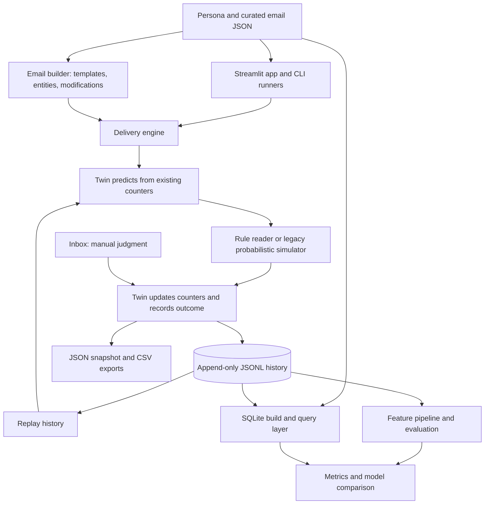

# ALERT — Phishing Response Digital Twin

## Project Overview

ALERT is a Python prototype for exploring phishing awareness training in a
fictional hospital. It simulates email responses, learns a separate response
profile for each staff persona, and compares a simple counting model with
supervised machine learning. A Streamlit interface supports simulation,
manual email judgments, feedback, and inspection of results.

The problem is how to estimate which kinds of phishing cues a person may miss
from observed actions, while keeping prediction separate from the mechanism
that generates those actions. The project provides an inspectable experiment
for that question; it does not establish predictive accuracy for real staff.
All personas and email scenarios are fictional.

**Scope:** This showcase describes the committed implementation at `7b49371`.
Local, uncommitted application changes are outside this description. Historical
measurements below are attributed to the repository report and were not rerun
for this document.

## Architecture



The shared [delivery engine](backend/engine.py) performs **pick → predict →
answer → update**. The app's Live and Run workflows call this engine so their
simulation logic stays consistent. [The twin](backend/twin.py) owns counters,
history, and persistence; [metrics](backend/metrics.py) produces DataFrames for
reporting. The backend and database layers do not depend on Streamlit.

The JSONL event log is the replayable record. JSON snapshots and CSV summaries
support convenient inspection, while [SQLite's schema](database/schema.sql)
and [build process](database/build.py) provide a queryable projection.
The schema separates hidden simulation probabilities from visible staff fields.

## Models and data

The tracked sources contain **25 fictional staff personas** and **51 curated
emails: 26 phishing and 25 legitimate**. See the
[roster](data/hospital_people.json) and [email catalogue](data/hospital_emails_mixed.json).

| Component | Implemented behavior |
|---|---|
| Counting twin | Per-person, per-cue estimate `a / (a + b)`, where phishing clicks increment `a` and reports increment `b`; no observations yields `0.0`. Legitimate-mail false reports have a separate counter. |
| Rule reader | Checks email fields and wording, including domains, Reply-To, links, attachment markers, and urgency. Awareness determines available checks; a rushed situation reduces checks. |
| Legacy simulator | Samples responses using persona probabilities; retained as an alternative answer generator in this committed version. |
| Majority baseline | Scikit-learn `DummyClassifier` using the most frequent class. |
| Logistic regression | Linear classifier with `max_iter=2000`. |
| Decision tree | Tree limited to depth 5. |
| Random forest | 200 trees, maximum depth 10, fixed random seed. |

[RuleReader](backend/reader.py) and the
[legacy SimulatedHuman](backend/human.py) generate responses; they are distinct
from the predictor. The twin learns from actions without consulting
`hidden_probs`.

The [ML pipeline](backend/ml_model.py) uses 15 input fields: eight categorical
fields encoded with one-hot encoding and seven numeric fields standardized
with `StandardScaler`. Inputs describe persona attributes and email structure.
The binary target is an incorrect judgment (`not correct`), which includes
both missed phishing and false alarms on legitimate mail. This is structured
feature modeling, rather than a language model or raw-text classifier.

## Technology stack and completed features

[Package configuration](pyproject.toml) specifies Python 3.10+, Streamlit,
pandas, Altair, NumPy, and scikit-learn, with setuptools packaging. Persistence
uses Python's JSON/CSV facilities and SQLite.

The committed implementation includes:

- A Streamlit dashboard with Live, Inbox, Person, All history, Run, Model, and
  Emails views in [app.py](app.py).
- Batch and terminal simulation through [main.py](main.py) and [live.py](live.py).
- Manual spam/not-spam judgments, explanatory feedback, per-person histories,
  and workforce summaries.
- New email construction from legitimate templates using technique-specific
  recipes, required/optional modifications, and entity substitutions in
  [email_builder.py](backend/email_builder.py),
  [modifications.py](backend/modifications.py), and [entities.py](backend/entities.py).
- Replayable event history, CSV exports, and SQL views for person, email, and
  cue-level analysis.
- Held-out-email ML evaluation, confusion matrices, classification reports,
  ROC AUC, feature importance, and a generated-email evaluation script.

## Engineering decisions

**Predict before observing the outcome.** The delivery engine calls prediction
before the answer generator and update. This preserves the ordering needed to
inspect an online prediction fairly.

**Keep an interpretable baseline.** Per-cue counters make it possible to explain
an estimate directly. Their cost is limited expressiveness: different emails
with the same cue receive the same per-person prediction.

**Hold out whole emails.** `split_by_email()` holds out approximately 30% of
unique email IDs with seed 7. This avoids putting repeated observations of the
same email into both ML training and testing. It does not hold out people or
entire template families.

**Preserve events before relying on summaries.** Log appends are flushed and
`fsync`ed; snapshots can be rebuilt from the log. This favors durability and
traceability, with disk overhead per delivery. It is not a substitute for a
transactional, concurrent storage design.

**Use procedural generation.** Email recipes keep modifications and teaching
notes inspectable without an external generation service. Independent entity
substitutions can nevertheless produce inconsistent prose.

## Evaluation methods and verified results

### Checks performed for this showcase

The committed JSON sources were parsed to confirm the 25-person roster and
26/25 email-label split. In an isolated export of commit `7b49371`,
`python3 -m tests.test_twin_all` completed successfully: 100 simulated emails
for each of 25 personas, with a printed overall mean absolute gap of **0.257**
from legacy hidden probabilities across the six counters. This is a runnable
demonstration, not an assertion-based test or a human-behavior result.

### Historical results recorded in the project report

The [complete project report](docs/PROJECT_COMPLETE_EXPLANATION.md) records
an ML run with 11,445 usable answers, 15 features, 8,109 training rows across
36 emails, and 3,336 test rows across 15 emails:

| Model | Reported accuracy | Reported ROC AUC |
|---|---:|---:|
| Majority baseline | 76.3% | 0.500 |
| Logistic regression | 73.2% | 0.757 |
| Decision tree | 89.9% | 0.828 |
| Random forest | 92.0% | 0.922 |

The report gives random-forest failure-class precision **0.937**, recall
**0.711**, and F1 **0.808**. Its confusion matrix contains 228 missed failures
out of 789 actual failures, illustrating why accuracy alone is insufficient.
AUC measures ranking; these figures alone do not establish calibration or
explain why a particular threshold performs poorly.

The same report records [evaluate.py](evaluate.py) matching **2,267 of 2,500
responses (90.7%)** on 100 newly generated emails across 25 personas, after
replaying 11,544 historical answers. That script evaluates phishing misses
and legitimate-mail false alarms separately and does not update the twin
with evaluation responses.

These are **historical report values, not newly reproduced benchmark scores**.
The required generated history is git-ignored, so a fresh clone cannot recreate
that exact training snapshot from tracked sources alone. The ML module also
states that its labels represent simulated rule-reader behavior, not measured
human behavior.

## Limitations and interpretation

- **Synthetic evidence:** Learning the rule reader's behavior demonstrates an
  experimental pipeline, not effectiveness with real users or improved training
  outcomes. No completed intervention study establishes behavior change.
- **Privileged features:** ML inputs include the known phishing label,
  red-flag count, and author-supplied metadata. Those are available inside this
  simulator but would need different treatment for unknown incoming mail.
- **Baseline contamination:** `twin_baseline()` rebuilds the counting twin from
  the full log, including held-out-email outcomes. The report's 91.5% twin
  score and claimed 0.5-point forest advantage are therefore not a clean
  comparison under identical training conditions.
- **Benchmark scoring bug:** [benchmark.py](backend/benchmark.py) treats any
  action other than `report` as failure, including correctly ignoring a
  legitimate email. Its mixed-email headline scores should not be used as
  evidence. `evaluate.py` contains label-aware outcome logic.
- **Historical data integrity:** The report identifies 49 mismatched email
  ID/subject records and 99 generated-email records omitted by the committed
  ML loader, which resolves only curated IDs. These affect interpretation of
  historical results.
- **Model scope:** The counting estimator has no smoothing or uncertainty
  interval. Phishing `ignore` actions are logged without changing its click/
  report counters. Situational inputs affect the reader but are absent from
  the ML feature set.
- **Validation and operation:** The committed `tests/` scripts are printing
  demonstrations, not an automated assertion suite. File-based shared state,
  per-event disk synchronization, and in-memory history limit scalability.
  This version does not establish production deployment readiness.

## Setup and exploration

Run from the repository root. These commands target the committed version
summarized here; generated outputs are local runtime data.

```bash
git clone https://github.com/vvek17/Digital_twin.git
cd Digital_twin
python3 -m venv .venv
source .venv/bin/activate
python -m pip install -e .
python -m streamlit run app.py
```

For an independent demonstration without saving history:

```bash
python main.py P09 30 --reader --fresh --no-save
python -m tests.test_twin_all
```

To collect rule-reader history and explore evaluation:

```bash
python main.py all 100 --reader
python -m database.build
python -m backend.ml_model
python evaluate.py 100
```

The collection command writes local history; model evaluation requires usable
history containing both target classes. New runs need not reproduce the
historical table. The legacy demonstration compares against hidden simulation
probabilities; it should not be interpreted as validation of the rule reader.

## Future work — proposed, not completed

1. Correct benchmark outcome handling and rebuild the counting baseline from
   training-only events before comparing models.
2. Validate historical email identity, retain exact generated messages, report
   excluded rows, and save versioned evaluation inputs and outputs.
3. Add assertion-based tests for prediction ordering, replay equivalence,
   counter invariants, dataset splits, and legitimate-email scoring; run them
   in continuous integration.
4. Evaluate repeated email-group splits, template-family holdouts, calibration,
   uncertainty, and decision thresholds chosen on validation data.
5. Compare smoothing and three-outcome modeling with the current estimator;
   improve entity consistency in generated prose.
6. Evaluate training effects using consented human-response data and a defined
   study protocol, then assess transactional storage and deployment needs if
   the application expands beyond a local prototype.

For a deeper code walkthrough, see the
[code explanation](docs/PROJECT_CODE_EXPLANATION.md) and
[connection map](docs/CONNECTION_MAP.md). The project's main technical value is
an inspectable path from simulated observations to per-person estimates,
replayable records, and model evaluation, with the limits of that evidence
made explicit.
