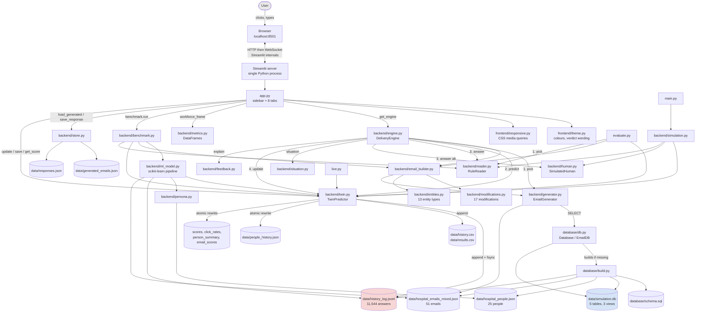

# Phishing Digital Twin - Complete Project Explanation

A study guide for explaining this project in detail. Every claim below was
checked against the code in this repository on 2026-10-29. Where something
could not be verified, or where the code and the documentation disagree, that
is said explicitly.

**Repository:** `/Users/vivek/phishing_twin` - GitHub: https://github.com/vvek17/Digital_twin

---

## Table of contents

1. [Project overview](#1-project-overview)
2. [Technology stack](#2-technology-stack)
3. [Frontend explanation](#3-frontend-explanation)
4. [Backend explanation](#4-backend-explanation)
5. [API documentation](#5-api-documentation)
6. [Database and storage](#6-database-and-storage)
7. [Architecture diagrams](#7-architecture-diagrams)
8. [Complete data flow, start to finish](#8-complete-data-flow-start-to-finish)
9. [File-by-file explanation](#9-file-by-file-explanation)
10. [Important code walkthroughs](#10-important-code-walkthroughs)
11. [Data science components](#11-data-science-components)
12. [Five feature execution traces](#12-five-feature-execution-traces)
13. [Professor presentation scripts](#13-professor-presentation-scripts)
14. [Technical questions and answers](#14-technical-questions-and-answers)
15. [Limitations and future improvements](#15-limitations-and-future-improvements)
16. [Glossary](#16-glossary)
17. [Beginner lesson, from zero](#17-beginner-lesson-from-zero)

---

# 1. Project overview

## 1.1 What the project does, in one paragraph

A fictional hospital (Ashbrook General, 320 beds) has 25 members of staff.
Simulated phishing emails and legitimate emails are delivered to them. Each
person answers: they click it, report it, or ignore it. A **digital twin** - a
software model of a person - watches those answers and learns to predict what
each person will do next, using nothing but counts of what it has already
seen. The twin is then graded on emails that did not exist when it learned.

Nothing in it is real. Fake hospital, fake names, and every email domain ends
in `.example`, which is a reserved suffix that cannot resolve on the internet.
No email is ever sent anywhere.

## 1.2 What problem it solves

Security awareness training is normally one-size-fits-all: everybody gets the
same annual module. The question this project is a vehicle for is:

> Can you predict, per person and per kind of pressure, who is going to fall
> for what - and can you do it without being told anything secret about them?

That is a **per-person behavioural prediction** problem. It is interesting
academically because of a constraint the project imposes on itself: each
simulated person has a hidden set of click probabilities (`hidden_probs`), and
**the twin is forbidden from reading them**. The twin must infer behaviour from
observed actions alone. The hidden numbers exist only so the twin can be
*graded* afterwards - like an examiner holding an answer key.

## 1.3 Intended users

Three audiences, in order of how much the code actually serves them:

| User | What they do with it |
|---|---|
| The researcher (you) | Runs simulations, compares the counting twin against machine-learning models, exports CSVs |
| A security trainer | Opens the Dashboard to see which pressure works on which role, uses the Inbox tab as a training exercise |
| A trainee | Plays the Inbox tab: judges emails as spam or not, gets explained feedback |

It is a research and teaching artifact, not a product. There is no login, no
multi-user support and no deployment configuration (verified: no `Dockerfile`,
no `.env`, no `.streamlit/` config, no cloud config of any kind).

## 1.4 Main features

1. **Dashboard** - the whole workforce at a glance: who clicks, and which cue, technique, address trick, difficulty, CIA category, week, or target role works best on people.
2. **Live** - deliveries happen one at a time, visibly, with the email shown as the person saw it and the probability counter updating on screen.
3. **Inbox** - *you* play a staff member. Judge an email spam or not spam and get a detailed explanation of what gave it away.
4. **Person** - one person's report card, split by what the email really was (accuracy on spam vs accuracy on genuine mail).
5. **All history** - every answer ever recorded, one row each, filterable and downloadable as CSV.
6. **Run** - the Live loop, batched and silent, up to 1,000,000 deliveries.
7. **Model** - trains a machine-learning model and races it against the counting twin on brand-new emails.
8. **Emails** - builds a brand-new email on demand and shows exactly what was changed relative to the genuine email it started from.

Plus four command-line programs (`main.py`, `live.py`, `evaluate.py`, and the
module entry points) that do the same work without a browser.

## 1.5 What happens when someone uses it

```
You type:  python3 -m streamlit run app.py
           Streamlit starts a small web server on http://localhost:8501
           Your browser opens it.
app.py     loads 25 people and 51 emails from disk, rebuilds the twin by
           replaying 11,544 past answers from the log, and draws 8 tabs.
You click  "Start" on the Live tab.
           Emails get built, delivered, answered and logged, 12 at a time,
           and the page redraws after each one.
Every answer is appended to data/history_log.jsonl and flushed to disk
immediately, so the record exists before anything else can go wrong.
```

## 1.6 Overall architecture in one sentence

It is a **single-process Python application** with a strict internal split:
`frontend/` and `app.py` draw things, `backend/` decides things, `database/`
stores and queries things - and the rule that holds the split together is that
**no file in `backend/`, `database/` or `scripts/` is allowed to import
Streamlit** (verified: `grep -l streamlit backend/*.py database/*.py
scripts/*.py` returns nothing).

There is no network between the frontend and the backend. They are Python
modules in the same process, communicating by function call. Section 5
explains why that matters and what the honest answer is when your professor
asks about APIs.

---

# 2. Technology stack

First, the words themselves, because the rest of the guide uses them.

- **Programming language** - the language source code is written in. Here: Python.
- **Library** - a bag of code someone else wrote that you call. You are in charge; you call it.
- **Framework** - like a library, but it is in charge. It calls *your* code at the moments it decides. Streamlit is a framework.
- **Server** - a program that waits for requests and answers them.
- **Package manager** - a tool that downloads and installs libraries. Python's is `pip`.
- **Dependency** - a library your project needs in order to run.

## 2.1 The complete list, as verified

| Technology | Version here | Role in this project |
|---|---|---|
| Python | 3.12.14 (project requires >= 3.10) | Every line of source code |
| Streamlit | 1.66.1 | The web framework: serves the page, draws every widget |
| pandas | 3.1.0 | Tables (DataFrames) for every chart, export and group-by |
| Altair | 6.3.0 | The charts (declarative, renders to Vega-Lite in the browser) |
| scikit-learn | 1.9.1 | The machine-learning pipeline: 4 models, encoders, metrics |
| NumPy | 2.5.4 | Numeric arrays underneath pandas and scikit-learn |
| SQLite | engine 3.53.4, via Python's built-in `sqlite3` | The queryable database, one file: `data/simulation.db` |
| setuptools | >= 68 | Builds the project so `backend`, `frontend`, `database` are importable |
| CSS | hand-written, in `frontend/responsive.py` | The only web technology written by hand: media queries for phone layout |

**Not used, and worth knowing you can say so confidently:** no JavaScript
written by hand, no React, no Node.js, no HTML templates, no FastAPI or
Flask, no REST API, no Docker, no cloud service, no authentication library, no
external API, no LLM API, no environment variables, no `requirements.txt`.

## 2.2 Each technology in detail

### Python

**What it is.** A general-purpose programming language, known for reading
close to English and for a very large scientific ecosystem.

**Why it is used.** Everything this project needs - a web UI, DataFrames,
machine learning, a database driver - exists in Python, so the whole system is
one language. For a data science project that is a real advantage: the model
code and the application code are the same code.

**What it does here.** All 8,925 lines of source (verified by `wc -l`).

**If removed.** There is no project.

**Alternatives.** R for the statistics (but no comparable web UI story);
JavaScript/TypeScript for the UI (but then the ML would have to live in a
separate Python service, which is exactly the complexity this project avoids).

### Streamlit

**What it is.** A Python framework for data applications. You write a normal
top-to-bottom Python script; Streamlit turns it into a web page. There is no
HTML and no JavaScript to write.

**The one idea you must understand about it.** Streamlit **re-runs your entire
script from line 1 every time the user interacts with the page.** Click a
button, move a slider, switch a tab - the whole of `app.py` executes again,
top to bottom. That is why:

- Anything expensive is wrapped in a cache: `@st.cache_data` on `get_people()` and `get_emails()` (`app.py:45` and `app.py:50`), `@st.cache_resource` on `get_builder()`, `get_readers()`, `get_humans()` (`app.py:97-110`). Without these, 25 personas and 51 emails would reload from disk on every single click.
- Anything that must survive the re-run lives in `st.session_state` - the twin itself, the live feed, the generated emails (`app.py:60-95`).
- A long blocking loop is forbidden. The Live tab runs a **burst of 12** deliveries and then calls `st.rerun()` (`app.py:690-707`), because Streamlit is single-threaded: while your loop runs, the Stop button cannot be processed. That reasoning is in the comment at `app.py:687-689`.

**Which files use it.** Exactly two places: `app.py` and `frontend/`. That is
the architectural rule of the project.

**If removed.** You lose the whole browser interface. The simulation would
still run: `main.py`, `live.py`, `evaluate.py` and all the `python3 -m
backend.*` entry points do not touch Streamlit. That is the payoff of the
no-Streamlit-in-the-backend rule.

**Alternatives.** Flask or FastAPI plus a React frontend - far more code, two
languages, and a real HTTP API to design. Dash or Gradio - closer to
Streamlit. Jupyter - no interactivity for a non-programmer.

**Why appropriate here.** The audience is a professor and a trainer, not a
customer. Streamlit buys a usable 8-tab interface for roughly 1,300 lines of
ordinary Python, with no frontend build step.

### pandas

**What it is.** A library whose central object is the **DataFrame**: a table
with named columns, like a spreadsheet you can compute on.

**What it does here.**
- `backend/metrics.py` turns the twin's history into three DataFrames: `workforce_frame` (one row per person), `cue_frame` (one row per person per cue), `history_frame` (one row per answer).
- Every Altair chart in `app.py` is fed a DataFrame.
- `backend/ml_model.py:build_dataset()` assembles the 11,445-row training table.
- Every `st.dataframe(...)` table and every "Download CSV" button.

**If removed.** Every group-by and rate calculation becomes a hand-written
Python loop, and Altair and scikit-learn both lose their natural input format.

**Alternatives.** Polars (faster, less universal), raw `csv` plus dicts (which
is what `backend/twin.py` already does for its own CSV writing - deliberately,
so the append-only writer has no heavy dependency).

### Altair

**What it is.** A **declarative** charting library. You do not draw; you
declare "x is this column, y is that column, colour is this third column" and
it produces the chart. Under the hood it emits Vega-Lite JSON, which
JavaScript in the browser renders.

**What it does here.** Five chart types: the horizontal "Who clicks" bar chart
(`app.py:296-325`), the grouped clicked-vs-recognised chart (`app.py:328-368`),
the "What works on people" breakdown bars with value labels
(`app.py:425-472`), and the live `P(click)` step line (`app.py:613-648`).

**Styling.** All colours come from `frontend/theme.py` so a bar, a metric and a
badge showing the same thing cannot each pick their own red. `CLICKED` is
`#e34948`, `RECOGNISED` is `#2a78d6`, and awareness uses one blue hue in three
ordinal steps.

**If removed.** Charts disappear; tables remain.

**Alternatives.** Matplotlib (imperative, no interactivity, no tooltips),
Plotly (interactive, heavier), native `st.bar_chart` (no control over colour or
tooltips).

### scikit-learn

**What it is.** The standard Python machine-learning library.

**What it does here** (`backend/ml_model.py`), all four of these pieces:
- `ColumnTransformer` + `OneHotEncoder` + `StandardScaler` - turn 8 text columns and 7 numeric columns into a numeric matrix.
- `Pipeline` - glues preprocessing to the model so the same transformation is applied at training and prediction time. This prevents a classic bug where you fit an encoder on training data and forget to apply it at prediction.
- Four classifiers: `DummyClassifier`, `LogisticRegression`, `DecisionTreeClassifier(max_depth=5)`, `RandomForestClassifier(n_estimators=200, max_depth=10)`.
- Metrics: `accuracy_score`, `roc_auc_score`, `confusion_matrix`, `classification_report`.

**If removed.** The Model tab and `backend/benchmark.py` stop working. The
counting twin is untouched - it is 7 lines of arithmetic in
`backend/twin.py:p_click()`.

**Alternatives.** XGBoost or LightGBM (stronger on tabular data), PyTorch
(unnecessary: this is 11k rows and 15 features, not a deep-learning problem).

### SQLite, through Python's `sqlite3`

**What it is.** A complete SQL database that is **one file on disk** with no
server process. `sqlite3` ships with Python, so there is nothing to install.

**What it does here.** `data/simulation.db` (2.5 MB) holds 5 tables and 3
views - a *queryable projection* of the JSON files and the log. The reason it
exists is in `database/db.py`'s own header comment: "hard phishing emails using
a forged From line, aimed at billing staff" is one SQL query instead of a
nested Python loop.

**The design decision worth defending.** The database is **not** the source of
truth. The JSON files and `history_log.jsonl` are. The database can be deleted
and rebuilt at any time with `python3 -m database.build`, and the builder drops
the tables and refills rather than updating in place - because, as
`database/build.py` says, a half-updated projection is harder to notice than a
missing one.

**If removed.** `backend/generator.py` would break immediately: it loads its
51 emails through `EmailDB` (which is an alias for `Database`). Everything else
reads JSON directly.

**Alternatives.** PostgreSQL or MySQL (a server to run, users to manage -
pointless for a single-user research tool), MongoDB (the data is relational:
people, emails, deliveries between them), or no database at all (which is what
the project started as).

### CSS, in `frontend/responsive.py`

**What it is.** The language that describes how a web page looks.

**What it does here.** The only hand-written web code in the project: a block
of CSS media queries injected once via `st.markdown(CSS,
unsafe_allow_html=True)`. It gives Streamlit's columns a minimum readable
width so `flex-wrap` collapses a row of four metrics to three, then two, then
one as the window narrows, rather than squeezing all four. Below 760px the
columns stack and the eight tabs scroll sideways.

**Why CSS and not Python.** There is no server-side way to know the browser
window width. CSS puts the decision in the browser, so the page reflows while
you drag the window, not only on reload. That reasoning is in the file's header
comment.

**Risk, stated honestly.** It targets Streamlit's own `data-testid` attributes
(`stHorizontalBlock`, `stColumn`, `stMetricValue`, `stTabs`). Those are the
documented styling hooks, but they belong to Streamlit, so a major Streamlit
upgrade is the thing that would break this file.

## 2.3 How the technologies connect

```
      browser  <--HTTP/WebSocket-->  Streamlit server  (Streamlit's own code)
                                           |
                                      app.py  +  frontend/
                                           |  plain Python function calls
                                      backend/
                                       /    |     \
                             pandas  numpy  scikit-learn
                                           |
                                      database/  -->  sqlite3  -->  simulation.db
                                           |
                                      data/*.json, *.jsonl, *.csv
```

The only network hop in the whole system is the top line, and Streamlit wrote
all of that code. Everything below it is in-process function calls.

---

# 3. Frontend explanation

## 3.1 What "frontend" means

The frontend is everything the user sees and touches: the layout, the buttons,
the charts, the text. The backend is everything that decides what those things
should say. In a conventional web app the frontend is HTML, CSS and JavaScript
running in the browser, and it is a separate program from the backend.

**In this project that is not the case, and you should say so plainly.** The
frontend is Python. Streamlit converts it into a web page. There is no
JavaScript file, no HTML file and no frontend build step in this repository.

## 3.2 Where the frontend lives

| Path | What it is |
|---|---|
| `app.py` (1,416 lines) | The entire user interface: the sidebar and all 8 tabs |
| `frontend/theme.py` (53 lines) | Colours, shared chart styling, the wording of a verdict |
| `frontend/responsive.py` (117 lines) | The CSS that makes it work on a narrow window and a phone |

`frontend/__init__.py` is a one-line file that only exists to make `frontend`
an importable Python package.

## 3.3 The starting point and how the page loads

`app.py` is the entry point. The startup sequence, in order of execution:

| Lines | What happens |
|---|---|
| `app.py:16-41` | Imports. Note the comment at line 34: "Nothing below this line opens a file, runs a delivery or computes a rate - it asks one of these and draws the answer." |
| `app.py:45-57` | `get_people()` and `get_emails()` load 25 personas and 51 emails, both cached |
| `app.py:60-76` | `reset_session()` rebuilds the twin by replaying the log, builds the feedback module, shuffles the Inbox order |
| `app.py:86-89` | The session-state guard: `if "twin" not in st.session_state: reset_session()`. This is what stops a reload on every click |
| `app.py:198-202` | `st.set_page_config(...)` then `responsive.inject()` - the CSS must come straight after the page config |
| `app.py:204-254` | The sidebar: person picker, answers-on-file metric, three toggles, reload button |
| `app.py:257-263` | Title, the `P(click)` caption, and `st.tabs([...])` creating all 8 tabs |
| `app.py:267-1416` | The eight `with tab_xxx:` blocks, each drawing one tab |

**How it reaches the browser.** `python3 -m streamlit run app.py` starts
Streamlit's own web server (a Tornado server) on port 8501. The browser
requests `http://localhost:8501`, receives Streamlit's static JavaScript
application, and that application opens a **WebSocket** - a two-way connection
that stays open - back to the server. Every widget interaction travels up that
WebSocket, Streamlit re-executes `app.py`, and the resulting element tree
travels back down it. You did not write any of that; Streamlit did.

## 3.4 How pages are created

There are no pages in the routing sense. There is one page with eight tabs,
created in a single call at `app.py:260`:

```python
tab_dash, tab_live, tab_inbox, tab_person, tab_history, tab_run, tab_model, tab_emails = st.tabs(
    ["Dashboard", "Live", "Inbox", "Person", "All history", "Run", "Model", "Emails"]
)
```

Each returned object is a container. `with tab_dash:` means "everything drawn
in this block belongs to the Dashboard tab".

**The important consequence:** switching tabs is not navigation. All eight tab
bodies execute on every single run of the script, every time. Streamlit just
shows one and hides the others. That is why `app.py:718-719` carries this
warning in the code:

```python
    # NB: never call st.stop() here - it halts the whole script, so every tab
    # rendered after this one would silently disappear. Guard with an if.
```

That is a real bug that was hit and fixed, and it is a good thing to be able
to explain: a beginner's instinct is `if not queue: st.stop()`, and that would
have silently deleted the Person, All history, Run, Model and Emails tabs.

## 3.5 How components are implemented

| Component | Streamlit call | Example in the code |
|---|---|---|
| Dropdown | `st.selectbox` | the staff member picker, `app.py:206` |
| Toggle switch | `st.toggle` | the three sidebar switches, `app.py:223`, `210`, `217` |
| Button | `st.button` | `Start`, `Stop`, `Clear`, `Spam`, `Not spam`, `Run now` |
| Number box | `st.number_input` | emails to deliver, 1 to 1,000,000, `app.py:1056` |
| Radio buttons | `st.radio` | "Break down by", "Show: All / Only wrong / Only correct" |
| Multi-select | `st.multiselect` | the person filter on All history, `app.py:1014` |
| Slider | `st.select_slider` | Live speed, options `[0.0, 0.1, 0.25, 0.5, 1.0]` |
| Big number | `st.metric` | "Phishing delivered", "Clicked", the counters |
| Table | `st.dataframe` | every table, fed a pandas DataFrame |
| Chart | `st.altair_chart` | the five Altair charts |
| Read-only email body | `st.text_area(..., disabled=True)` | every place an email is shown |
| Progress bar | `st.progress` | the Run tab and the Model tab |
| Expander | `st.expander` | "Counters and full history", "Table view" |
| File download | `st.download_button` | All history CSV, model predictions CSV |
| Placeholder | `st.empty()` | the five Live-tab boxes, `app.py:545-549` |

`st.empty()` deserves its own note, because it is how the Live tab animates.
Five empty placeholders are created once; `render_live()` then fills them with
`with status.container():` and friends. Calling it again **replaces** the
contents in place rather than appending, which is what makes the feed look
like it is updating rather than growing forever.

## 3.6 How user input is handled

Streamlit widgets work in one of two ways, and this app uses both.

**Return-value widgets.** `st.button(...)` returns `True` on exactly the one
re-run that follows the click. So the pattern is:

```python
start = st.button("Start", ...)      # app.py:525
if start:
    st.session_state.live_running = True
```

**Keyed widgets.** Passing `key="use_reader"` tells Streamlit to store the
widget's value in `st.session_state["use_reader"]` and keep it across re-runs.
That is how the three sidebar toggles work, and it is what lets any tab ask
"is the reader currently on?" without the toggle being nearby:

```python
st.toggle("Read the email", key="use_reader", value=True, help=...)   # app.py:223
...
def answerer_for(person_id):                                          # app.py:115
    if st.session_state.get("use_reader", True):
        return get_readers()[person_id]
    return get_humans()[person_id]
```

`answerer_for` is passed into the engine as a **callable, not a value**
(`app.py:122-133`), with this comment on `get_engine()`: "Rebuilt per call
rather than cached: the toggles decide who answers and how the email is
chosen, and a cached engine would keep the old answer." That is a genuinely
good design decision and a strong thing to point at in a meeting.

## 3.7 How the frontend knows data changed

It does not get told. **It re-reads everything on every re-run.** The flow is:

1. User does something.
2. Streamlit re-executes `app.py` from line 1.
3. `twin = st.session_state.twin` - the same twin object, carried across the re-run.
4. Each tab calls into the backend again: `workforce_frame(twin, people)`, `twin.get_history(...)`, `twin.get_score(...)`.
5. Whatever comes back is drawn.

There is no reactivity system, no observers and no subscriptions. "Re-run
everything and redraw" is the entire model. It is simple, and it is why the
caches matter so much.

## 3.8 How the frontend communicates with the backend

By calling Python functions. Both halves are in the same process and the same
memory. `workforce_frame(twin, people)` on `app.py:268` is a direct function
call into `backend/metrics.py`; the DataFrame it returns is the same object in
memory, not a copy serialised over a network.

Section 5 sets out the full table of these calls, which is the honest
equivalent of an API reference for this project.

## 3.9 Three frontend features, traced step by step

### Feature A: the "Break down by" radio on the Dashboard

**What the user sees.** A row of eight options - Cue, Technique, Address
trick, Difficulty, CIA hit, Week, Category, Target role - and a bar chart that
changes when you pick a different one.

**Step by step:**

1. `app.py:378-389` defines the mapping from the label the user sees to the field name on an email object:
   ```python
   BREAKDOWNS = {"Cue": "cue", "Technique": "technique",
                 "Address trick": "address_trick", "Difficulty": "difficulty",
                 "CIA hit": "cia_hit", "Week": "week",
                 "Category": "technique_category", "Target role": "target_role"}
   dim = st.radio("Break down by", list(BREAKDOWNS), horizontal=True)
   field = BREAKDOWNS[dim]
   ```
2. The user clicks "Technique". Streamlit sends the click up the WebSocket and re-runs `app.py` from line 1. This time `st.radio` returns `"Technique"`, so `field == "technique"`.
3. `app.py:398-399` builds a lookup of every email, curated and built:
   ```python
   email_by_id = {e["id"]: e for e in emails}
   email_by_id.update({e["id"]: e for e in st.session_state.generated})
   ```
   This matters: the history stores only the email *id*, so to group by any field on the email it has to be joined back to the email object.
4. `app.py:400-414` loops over every person and every answer in the twin's history, keeps only phishing answers, looks up the source email, and records `{"type": src_email.get(field, "-"), "fooled": not ev["correct"]}`.
5. `app.py:417-423` builds a DataFrame, groups by `type`, and computes `rate = fooled / asked`.
6. `app.py:425-472` declares the Altair bar chart plus a text layer of percentage labels, and `st.altair_chart` sends the Vega-Lite spec to the browser, which draws it.

**The one thing to notice:** step 3 silently drops any answer whose email can
no longer be found - `if not src_email: continue`. With the current data that
is the 99 answers whose emails were built on the fly in sessions whose
generated-email file has since been replaced.

### Feature B: the Live tab, start to a visible arrival

1. User clicks **Start**. `app.py:525` returns `True`, so `app.py:536-537` sets `st.session_state.live_running = True`.
2. The script continues to `app.py:545-549`, which creates five `st.empty()` placeholders, and `app.py:686` calls `render_live()` once to draw the current (empty) state.
3. `app.py:690` sees `live_running` is true and enters the burst loop: `for _ in range(12)`.
4. Each iteration calls `live_step()` (`app.py:135`), which calls `get_engine().deliver(...)` - the real backend work, described in section 4 - and gets back one record dict.
5. `app.py:698-699` pushes the record onto the front of the feed and truncates it: `st.session_state.live_feed.insert(0, rec)` then `del st.session_state.live_feed[10:]`. The feed is capped at 10.
6. `render_live()` is called again, re-filling all five placeholders in place: the four metrics, the email exactly as the person saw it, the `P(click)` line chart, the 10-line feed, and the two leaderboards.
7. `time.sleep(delay)` pauses for the slider's value.
8. After 12 iterations, `app.py:703` saves the twin, `app.py:704-706` writes the generated-email file if any were built, and `app.py:707` calls `st.rerun()` - which starts the whole script again and, because `live_running` is still true, runs the next burst. That is the loop.

**The design point to be able to defend:** why bursts of 12 instead of one
long `while` loop? Because Streamlit is single-threaded. A long loop never
yields, so the server never processes the Stop click. Twelve is short enough
that Stop feels responsive and long enough that the overhead of a full
script re-run is amortised.

### Feature C: answering an email in the Inbox tab

1. `app.py:714-730` computes what is left to ask: the ids this person has already answered, subtracted from the shuffled order held in `st.session_state.order`.
2. `app.py:736-749` draws the email - From, Subject, body in a disabled text area - and two buttons, `Spam` and `Not spam`.
3. The user clicks **Spam**. `said_spam` is `True` on the next re-run (`app.py:745`).
4. `app.py:748-758` translates the button into a simulation action. This translation is the heart of the feature:
   ```python
   if said_spam:
       action = "report"
   else:
       action = "click" if email["label"] == "phishing" else "ignore"
   ```
   "Not spam" means they trusted it. On a phishing email trusting it *is* the click; on a genuine email it is the correct non-action. One button, two different meanings depending on what the email really was.
5. `twin.update(person_id, email, action, source="app")` - the counters move and the answer is appended to the log with `source="app"` rather than `"sim"`, so a real person's answer is distinguishable forever.
6. `twin.save(people_by_id=people_by_id)` writes the snapshot and the four summary CSVs.
7. `app.py:760-763` asks the feedback module for an explanation and parks it in `st.session_state.last_feedback`.
8. `store.save_response({...})` appends the answer to `data/responses.json` - the only file in the project that nothing can regenerate, because a human typed it.
9. `st.rerun()`. The next run finds `last_feedback` populated and the right-hand column at `app.py:780-812` draws the verdict, the technique, the tells, the hidden link, the Reply-To, the key defence and the history note.

---

# 4. Backend explanation

## 4.1 What a backend is, and why this project needs one

The backend is the part that decides. It holds the rules, does the
calculations, and owns the data. The frontend only asks it questions and draws
the answers.

This project needs one for a specific reason worth stating in a meeting: the
same simulation has to be runnable from **four different front doors** -
the Streamlit app, `main.py`, `live.py` and the test scripts. If the logic
lived inside `app.py`, only the browser could run it, and the terminal
versions would have to reimplement it. That actually happened and was fixed:
`backend/engine.py`'s header comment records that the Live tab and the Run tab
"used to hold two copies of this code, which is how they drifted apart."

## 4.2 Where the backend lives, and the rule that defines it

`backend/` holds 18 modules. The rule, stated in `README.md` and `STRUCTURE.md`
and verified true: **no file in `backend/`, `database/` or `scripts/` imports
Streamlit.** If a module draws, it is frontend. If it decides, it is backend.

There is no separate backend server. "Starting the backend" is not a thing
you do in this project - the backend is a set of Python modules that the
frontend imports. Section 5 explains how to answer the professor's inevitable
"how does your frontend talk to your backend" question honestly.

## 4.3 The 20 backend modules by job

**The people and the emails**

| File | Lines | Job |
|---|---|---|
| `persona.py` | 51 | One member of staff, loaded from JSON into a `Persona` object |
| `generator.py` | 103 | Chooses *which* email a person gets next. Four strategies |
| `situation.py` | 23 | The moment an email arrives: time of day and how busy they are |

**Who answers the email** - two competing models of a person

| File | Lines | Job |
|---|---|---|
| `reader.py` | 229 | `RuleReader` - answers by **inspecting the email**. Deterministic |
| `human.py` | 96 | `SimulatedHuman` - answers by **rolling dice** against `hidden_probs`. Never reads the email |

**The twin and the loop**

| File | Lines | Job |
|---|---|---|
| `twin.py` | 706 | `TwinPredictor`: the counting model, plus all log and CSV writing |
| `engine.py` | 170 | `DeliveryEngine`: one delivery, four steps, in order |
| `simulation.py` | 141 | Many deliveries for one person, plus the grading against `hidden_probs` |
| `feedback.py` | 135 | Explains to the person what they just got right or wrong |
| `store.py` | 92 | Reads and writes the app's own data files; archives the append-only files |
| `metrics.py` | 87 | Turns the twin's history into three pandas DataFrames |

**Building new emails**

| File | Lines | Job |
|---|---|---|
| `modifications.py` | 413 | The catalogue of 17 named ways to make an email phishy, in 4 families |
| `entities.py` | 307 | Finds and replaces the changeable values: ticket refs, wards, days, times |
| `email_builder.py` | 274 | Genuine email + modifications = a new email. 11 technique recipes |
| `db_builder.py` | 272 | The same, but picks its starting email by SQL query instead of at random |
| `email_generator.py` | 268 | Builds one on demand and rejects it if too similar to anything already made |

**The machine learning**

| File | Lines | Job |
|---|---|---|
| `ml_model.py` | 309 | The scikit-learn pipeline: features, grouped split, train, evaluate, inspect |
| `benchmark.py` | 116 | The ML model against the counting twin, on brand-new emails |

## 4.4 How the backend "starts"

It does not start; it is imported. Three different startup paths exist:

| Entry point | What it constructs |
|---|---|
| `app.py` | `reset_session()` builds `TwinPredictor.from_log()`, `FeedbackModule("detailed")`; cached factories build one `RuleReader` and one `SimulatedHuman` per person and one `EmailBuilder`; `get_engine()` builds a fresh `DeliveryEngine` on every call |
| `main.py` | `load_people()`, `EmailGenerator()`, `TwinPredictor.from_log()` (or a blank one with `--fresh`), then one `Simulation` per person |
| `live.py` | `LiveRun.__init__` (`live.py:50-74`) builds the same set, plus its own per-person tallies, and uses `SimulatedHuman` only |

Note the asymmetry, because it is the kind of thing a professor spots:
`live.py` uses `SimulatedHuman` exclusively (`live.py:59`), while the app
defaults to `RuleReader`. `main.py` can use either, via the `--reader` flag.

## 4.5 The central object: `TwinPredictor`

`backend/twin.py` is the largest backend file (706 lines) and holds two
distinct responsibilities - which is itself a fair criticism to raise before
your professor does:

1. **The model.** Six counters per person, and the division `a / (a + b)`.
2. **All persistence.** The append-only log, the append-only history CSV, the short results CSV, and four rewritten summary CSVs.

### The model, in full

Each person gets six counters, created lazily by `_counters_for()`
(`twin.py:288-302`):

```python
"urgency":      {"a": 0, "b": 0},     # phishing cues: a = clicked, b = reported
"authority":    {"a": 0, "b": 0},
"it_login":     {"a": 0, "b": 0},
"hr_payroll":   {"a": 0, "b": 0},
"billing":      {"a": 0, "b": 0},
"false_report": {"a": 0, "b": 0},     # legitimate: a = reported by mistake, b = not
```

and the whole predictive model is seven lines (`twin.py:311-316`):

```python
@staticmethod
def p_click(a, b):
    if a + b == 0:
        return 0.0
    return a / (a + b)
```

That is it. **That is the digital twin.** Six fractions per person, 150
numbers for the whole workforce. Being able to say that plainly, and then
defend it against a 200-tree random forest (section 11), is the strongest
moment available to you in this meeting.

### Each major function on the twin

| Function | Triggered by | Input | Does | Calls | Output | Where output goes |
|---|---|---|---|---|---|---|
| `predict(person_id, email)` | `engine.deliver`, `simulation.step`, `evaluate.py`, `benchmark.run` | a person id and an email dict | looks up the counter for this email's cue and divides | `_counters_for`, `_key_for`, `p_click` | a float 0.0-1.0 | compared against the eventual action |
| `update(person_id, email, action, source)` | after the person answers | id, email, `"click"`/`"report"`/`"ignore"`, `"sim"` or `"app"` | moves one counter, computes `correct`, appends a 19-field history record | `_counters_for`, `_key_for`, `p_click`, `_append_log`, `_append_csv` | nothing | `self.history`, `history_log.jsonl`, `history.csv`, `results.csv` |
| `_key_for(email)` | `predict`/`update` | an email | returns `email["cue"]` for phishing, `"false_report"` for legitimate | - | a counter name | selects which of six counters moves |
| `rebuild_from_log(path)` | `from_log()`, `evaluate.py`, `ml_model.build_dataset` | the log path | replays every line, restoring counters and history; counts unparseable lines | - | number of rows replayed | the twin's in-memory state |
| `save(path, people_by_id)` | Live stop, Inbox answer, Run finish, `main.py` | - | writes the snapshot atomically, then three summary CSVs | `get_totals`, `write_scores`, `write_click_rates`, `write_person_summary` | the path | `people_history.json`, `scores.csv`, `click_rates.csv`, `person_summary.csv` |
| `get_score(person_id)` | Dashboard, Person tab | a person id | counts answered, correct, wrong, clicked, missed spam, false alarms | - | a dict of 9 numbers | the Person tab's three accuracy metrics |
| `get_totals(person_id)` | `save`, `metrics.cue_frame`, Person tab | a person id | yes / no / all / p_click per cue | `p_click` | a dict of 6 dicts | the counters table |
| `write_email_scores(emails_by_id)` | Run tab, `main.py` | id-to-email map | tallies per email, sorts hardest-phishing first | - | the path | `data/email_scores.csv` |

### The two kinds of mistake

This is the conceptual point the code keeps returning to. There are two ways
to be wrong, and they cost different things:

- **Missed spam** - trusted a phishing email. The dangerous error.
- **False alarm** - reported a genuine email. Harmless but wastes someone's time.

`update()` encodes it (`twin.py:363-367`):

```python
if email["label"] == "phishing":
    correct = action == "report"
else:
    correct = action != "report"
```

and `get_score()` reports them separately as `missed_spam` and `false_alarms`,
which is why the Person tab shows accuracy on spam and accuracy on genuine
mail as two different numbers. One overall accuracy figure would hide the
asymmetry: a person who answers "real" to everything scores 100% on genuine
mail and 0% on spam.

## 4.6 The delivery engine: one delivery, four steps

`backend/engine.py` is the most important file to understand. 170 lines, and
the whole simulation funnels through it. `DeliveryEngine.deliver()`
(`engine.py:89-141`) does exactly four things in a fixed order:

```
1. pick      an email: built fresh, or drawn from the 51
2. predict   the twin guesses, from its counters alone
3. answer    the person decides (reader inspects, or human rolls)
4. update    the counters move, and the answer is appended to the log
```

**Why the order is not negotiable.** The code says it at `engine.py:19-20`:
"Step 2 has to come before step 3. The prediction is only worth anything if it
was committed before the outcome existed." If you predicted after seeing the
answer you would be describing, not predicting. This is the project's
methodological backbone and the single best thing to point at when asked how
you avoided fooling yourself.

Reading the actual sequence (`engine.py:112-116`):

```python
situation = make_random_situation()

predicted = self.twin.predict(person.id, email)
action = self.answerer_for(person.id).respond(email, situation)
self.twin.update(person.id, email, action, source="sim")
```

`self.answerer_for` is a **callable supplied by the caller**, not a fixed
object. The app passes a function that reads the sidebar toggle. That is how
one engine serves both answering models without knowing either exists.

### `pick()` - choosing the email

`engine.py:61-80` has three branches:

1. `build_new=True` - call `builder.build_any(new_id=next_email_id(...))`, which returns a brand-new phishing or legitimate email, 50/50.
2. `build_new=False, allow_repeats=True` - `random.choice(self.emails)` from the 51.
3. `build_new=False, allow_repeats=False` - only an email this person has not seen, via `generator.get_unseen(seen)`. Returns `None` when they have seen all 51, which raises `NothingLeft`, which `deliver()` catches and converts to `None`.

That last conversion is deliberate (`engine.py:93-94`): "Returns None when
there is nothing left to ask, rather than raising - a caller looping over
deliveries wants to stop, not handle an error."

### `next_email_id()` - why ids never collide

`engine.py:32-40` takes the maximum integer id across both the curated set and
everything generated so far, and adds one. The curated set holds 1-51, so
built emails start at 52 and climb. A generated email can therefore never
shadow a curated one. Section 15 records the one historical incident where
this guarantee did not yet exist, and the 49 rows it left behind.

## 4.7 The two models of a person

This is the most academically interesting part of the backend, and the thing
your professor is most likely to push on. There are **two completely different
implementations of "a person answering an email"**, with the same interface -
`respond(email, situation)` returning `"click"`, `"report"` or `"ignore"`.

### `SimulatedHuman` (`backend/human.py`) - the probabilistic model

Two layers decide an action:

1. **Personality** - the person's fixed `hidden_probs`, e.g. `{"urgency": 0.348, "authority": 0.149, "it_login": 0.128, "hr_payroll": 0.02, "billing": 0.02, "false_report": 0.155}` for P01.
2. **Situation** - the moment the email arrives, which nudges that chance.

The nudges (`human.py:63-88`) are each a documented additive adjustment:

| Condition | Effect on click chance |
|---|---|
| `time_of_day == "night"` | +0.10 - night is tiring |
| the email arrives during this person's own shift | +0.05 - it feels expected |
| `busy_now == "very busy"` | +0.10 - a rush makes people careless |
| `busy_now == "normal"` | -0.05 - a calm moment makes them careful |
| a `billing` email to the Finance & Billing department | +0.10 - it looks like their normal work |

then clamped to `[0.02, 0.95]` and compared against `random.random()`. If they
do not click, a second roll against `REPORT_CHANCE` (`{"high": 0.50,
"medium": 0.25, "low": 0.10}`, minus 0.05 when very busy) decides whether they
report it or merely ignore it.

**The criticism this model attracted, in the project's own words**
(`reader.py:5`): "That number was invented, and the email played no part -
which is what the course feedback objected to." Under this model, the exact
same person given two completely different phishing emails with the same cue
behaves identically in expectation. The content of the email is irrelevant.

### `RuleReader` (`backend/reader.py`) - the deterministic model, now the default

The answer here is produced by **actually inspecting the email**. Eight checks
exist, each returning a reason string or `None`:

| Check | What it looks at |
|---|---|
| `check_sender_domain` | is the From domain `ashbrookgeneral.example`? |
| `check_reply_to_mismatch` | does Reply-To point to a different domain than From? |
| `check_link_mismatch` | does the link go to a different domain than the sender? |
| `check_urgency_language` | 14 deadline phrases: "urgent", "within 24 hours", "final notice", ... |
| `check_pressure_language` | 11 secrecy/threat phrases: "keep this between us", "this is your only notice", ... |
| `check_credential_request` | 13 phrases like "sign in", "verify your", "bank details" - but only if there is a link |
| `check_dangerous_attachment` | 7 markers: `.exe`, `.zip`, `.docm`, `.xlsm`, "enable content", "macro" |
| `check_generic_greeting` | does the first line start with "Greetings:", "Dear Staff", "Hello all", ... |

**People differ by which checks they run, not by how lucky they are**
(`reader.py:34-55`). `security_awareness` maps onto a habit level:

```python
SKILL_FOR_AWARENESS = {"low": "careless", "medium": "average", "high": "careful"}
```

- `careless` runs **1** check: generic greeting only.
- `average` runs **4**: greeting, sender domain, urgency, attachments.
- `careful` runs **8**: all of them.

The verdict rule is a logical OR: `"spam" if any check fires else "not spam"`.
Then `respond()` converts a verdict into an action (`reader.py:204-219`):
reporting if spam, otherwise "click" on a phishing email and "ignore" on a
genuine one.

**The situation still matters, but differently.** `checks_for(situation)`
(`reader.py:189-202`) models rushing not as bad luck but as *looking less*:

```python
QUICK_CHECKS = 2
rushed = (situation.get("busy_now") == "very busy"
          or situation.get("time_of_day") == "night")
if rushed:
    return self.checks[:self.QUICK_CHECKS]
```

A careful reader under pressure drops from 8 checks to the first 2. The
comment states the reasoning: "Rushing does not change what someone knows, it
changes how much they bother to look."

**Why this is the better model, and the honest caveat.** It is better because
every answer is traceable to a property of the email you can point at, and
because the same person given the same email in the same situation always
answers the same way. The caveat is that it is a **checklist, not a human**.
Any model trained on its answers is learning to reproduce a checklist, and
`ml_model.py:16-20` says so in its own header. Section 11 returns to this.

## 4.8 Business logic implemented

| Rule | Where | What it says |
|---|---|---|
| `P(click) = yes / (yes + no)` |  `twin.py:312` | The entire predictive model |
| Ignoring moves no counter | `twin.py:335-341` | Ignoring is neither arrow on the diagram, so it is logged but does not change `a` or `b` |
| Predict before answer | `engine.py:114-116` | A prediction only counts if committed before the outcome existed |
| The twin may never read `hidden_probs` | enforced by convention and by file layout | `hidden_probs` is read in exactly four places, all grading code: `simulation.results()`, `tests/test_twin.py`, `tests/test_twin_all.py`, `tests/test_persona.py`. It is also a separate SQL table |
| Two kinds of error, counted separately | `twin.py:363-367`, `get_score` | Missed spam and false alarms are not interchangeable |
| Hold out whole emails, not rows | `ml_model.py:split_by_email` | Random row splits would leak the same email into train and test |
| Built emails get ids above the curated max | `engine.py:32-40` | A generated email can never shadow a curated one |
| Every phishing email must have something wrong with the sender | `email_builder.py:176-178` | If the recipe did not pick an address trick, one is added |
| Built emails are balanced 50/50 | `email_builder.py:160-163` | Otherwise "always answer spam" would score perfectly |

That last one is a genuinely sharp piece of reasoning and worth memorising.
`build_any()` returns a legitimate email half the time, built through the same
entity-swapping pipeline as the fakes. Without it, every dynamically built
email would be phishing, and a model could score 100% by always predicting
"spam" - which would tell you nothing.

## 4.9 What happens when an error occurs

Error handling in this project is deliberate in a few places and absent in
most. Honest summary:

**Handled deliberately:**

| Situation | Where | Behaviour |
|---|---|---|
| A half-written final line in the log, from a crash mid-write | `twin.py:257-262`, `build.py:124-129` | The line is counted as damaged and skipped; every complete line before it is still good |
| The snapshot file is missing or corrupt | `twin.py:461-465` | `load()` returns `False`. Not an error: it means nobody has any history yet |
| The generated-emails file is missing or malformed | `store.py:42-48` | Returns an empty list |
| Nothing left to deliver | `engine.py:89-99` | Returns `None`; the Live loop stops and shows a warning |
| A person has already answered every email | `main.py:45-52` | Prints a message instead of indexing an empty list |
| The ML comparison fails for any reason | `app.py:1168-1169` | `except Exception as exc: st.error(...)` - the one broad catch in the app |
| A crash during a snapshot write | `twin.py:444-449` and `store.py:28-36` | Write to a `.tmp` file then `os.replace`, which is atomic, so the previous snapshot survives intact |
| A crash during an append | `twin.py:146-149` | `f.flush()` then `os.fsync()`, so the line is on disk before anything else happens |

**Not handled:** a missing `data/hospital_people.json` or
`data/hospital_emails_mixed.json` raises an uncaught exception and the app
fails to start. That is arguably correct behaviour - those files are the
sources and there is nothing sensible to do without them - but it is an
uncaught crash, not a handled error, and you should describe it that way.

## 4.10 Security and authentication

**There is none, and that is the accurate answer.** Verified: no login, no
session tokens, no password handling, no `.env` file, no secrets of any kind,
no authentication library in the dependency list.

What exists instead, and is worth describing as a deliberate choice:

- **The app binds to localhost.** Streamlit's default is `localhost:8501`, reachable only from your own machine.
- **Nothing leaves the machine.** No outbound network call exists anywhere in the codebase - no `requests`, no `urllib`, no API client.
- **No email is ever sent.** The entire corpus is data in a JSON file. Every domain ends in `.example`, a suffix reserved by RFC 2606 precisely so that it cannot resolve.
- **The data is synthetic.** 25 fictional people, so there is no personal data to protect and no ethics approval question about real staff.
- **The one real access-control idea in the project is internal:** `hidden_probs` is held in its own SQL table, separate from `people`, specifically so that a query which joins it into a prediction is visibly cheating. `database/schema.sql:70-77` spells this out: "read it to score, never to predict."

If the app were ever deployed for multiple users, section 15 lists what would
have to be built first. The honest framing is: this is a single-user research
tool run on a laptop, and its security model is that it has no attack surface.

---

# 5. API documentation

## 5.1 Read this first: the honest answer

Your professor will almost certainly ask how your frontend communicates with
your backend, and what your API endpoints are. **This project does not have
any HTTP API endpoints, and you must not invent them.** Verified: there is no
`@app.route`, no `@app.get`, no FastAPI, no Flask, no `requests`, no `fetch`,
and no URL path defined anywhere in the codebase.

Here is how to answer so that it reads as understanding rather than as a gap:

> "The frontend and backend in my project are not separate programs, so
> there is no HTTP API between them. Streamlit runs the frontend and the
> backend in one Python process, so the frontend calls backend functions
> directly - `engine.deliver()`, `twin.predict()`, `metrics.workforce_frame()`.
> The boundary is still real and enforced: nothing in `backend/` imports
> Streamlit, so the backend has no idea a web interface exists, which is why
> the same code runs from the command line and from the tests. The one HTTP
> and WebSocket layer in the system is Streamlit's own, between the browser
> and the server process - I did not write it. If this needed to become a
> multi-client system, the step would be to put FastAPI in front of
> `backend/`, and the module boundary is already drawn in the right place for
> that."

That answer is better than a fabricated endpoint table, and it is true.

## 5.2 The concepts, defined properly, because you still need them

**API (Application Programming Interface).** The agreed set of operations one
piece of software offers to another. It does not have to involve a network.
`twin.predict(person_id, email)` is an API: it is a documented operation with
inputs and an output, and callers depend on its shape. "API" has come to mean
"web API" colloquially, but the general meaning is the one that applies here.

**API endpoint.** In a *web* API, one specific URL that performs one
operation, e.g. `POST /api/deliveries`. This project has none.

**HTTP request.** A text message a browser sends to a server: a method, a
path, headers, and optionally a body. The server replies with a status code
(200 OK, 404 Not Found, 500 Server Error) and a body.

**The HTTP methods**, with what each one would mean if this project had a web API:

| Method | Meaning | What it would be here |
|---|---|---|
| GET | fetch something, change nothing | `GET /people`, `GET /history?person=P09` |
| POST | create something new | `POST /deliveries` - run one delivery |
| PUT | replace something entirely | `PUT /people/P09` - overwrite that person |
| PATCH | change part of something | `PATCH /people/P09` - change only their awareness |
| DELETE | remove something | `DELETE /history` - archive the log |

**JSON (JavaScript Object Notation).** A text format for structured data,
using `{...}` for key-value objects and `[...]` for lists. It is the usual way
two programs exchange data over a network. This project uses JSON heavily -
but as a **file format on disk**, not as a wire format. `hospital_people.json`,
`hospital_emails_mixed.json`, `history_log.jsonl` and `responses.json` are all
JSON; none of them is ever sent anywhere.

**JSONL (JSON Lines).** One complete JSON object per line, as in
`history_log.jsonl`. The reason for this format rather than one big JSON array
is important: a JSON array must be rewritten in full to add an element,
whereas a JSONL file can be **appended** to. Appending is what makes the log
tamper-evident - no existing line is ever reopened.

**What happens if the backend is unavailable.** In a two-program
architecture, the frontend would get a connection error and could show a
cached or degraded view. Here, the backend cannot be unavailable
independently: it is the same process. If the backend fails, the failure
surfaces as a Python exception, and Streamlit prints the traceback into the
page where that element would have been drawn. The rest of the page still
renders. If the *process* dies, the browser shows Streamlit's
"connection lost" banner and retries - and because every answer was fsync'd
to the log as it happened, nothing already recorded is lost.

## 5.3 The real interface: the in-process function API

This is the equivalent of an endpoint table for this project. Every row is a
real call, verified in the code.

### Delivering emails

| Operation | `DeliveryEngine.deliver(person=None, build_new, allow_repeats, generated, targets)` |
|---|---|
| Analogous to | `POST /deliveries` |
| Frontend caller | `app.py:135` `live_step()` (Live tab) |
| Backend handler | `backend/engine.py:89` |
| Input | toggles from the sidebar; a person is chosen at random if not given |
| Processing | pick -> predict -> answer -> update; builds a feedback note |
| Output | a dict of 20 fields: time, person, email, action, predicted, p_before, p_after, yes, no, all, feedback, ... |
| Errors | returns `None` when nothing is left to deliver |
| Side effects | one line appended to `history_log.jsonl`, `history.csv`, `results.csv` |

| Operation | `DeliveryEngine.deliver_many(count, targets, build_new, allow_repeats, generated, on_progress, on_record)` |
|---|---|
| Analogous to | `POST /deliveries/batch` |
| Frontend caller | `app.py:1092` (Run tab, "Run now") |
| Backend handler | `backend/engine.py:149` |
| Input | up to 1,000,000; targets = everyone or one person |
| Processing | calls `deliver()` in a loop; invokes `on_progress` every 200 deliveries so the progress bar moves |
| Output | `(delivered, skipped)` |
| Errors | counts skips rather than raising |

### Predicting and recording

| Operation | `TwinPredictor.predict(person_id, email)` |
|---|---|
| Analogous to | `GET /predict?person=P09&email=12` |
| Callers | `engine.deliver`, `simulation.step`, `evaluate.py:57`, `benchmark.py:58` |
| Backend handler | `backend/twin.py:324` |
| Input | a person id, an email dict |
| Processing | `_key_for(email)` picks the counter; `p_click(a, b)` divides |
| Output | float 0.0-1.0 |
| Errors | none possible: an unknown person gets fresh zeroed counters |

| Operation | `TwinPredictor.update(person_id, email, action, source)` |
|---|---|
| Analogous to | `POST /answers` |
| Callers | `engine.deliver` (`source="sim"`), `app.py:756` Inbox (`source="app"`), `simulation.step` |
| Backend handler | `backend/twin.py:330` |
| Input | person id, email, one of `click` / `report` / `ignore`, source tag |
| Processing | moves one counter, computes `correct`, builds a 19-field record |
| Output | nothing returned; state and files change |
| Errors | unhandled disk errors propagate |

### Reading aggregates

| Operation | Called from | Handler | Returns |
|---|---|---|---|
| `metrics.workforce_frame(twin, people)` | `app.py:268` Dashboard | `backend/metrics.py:18` | DataFrame, one row per person: seen, clicked, reported, click_rate, report_rate |
| `twin.get_score(person_id)` | Dashboard + Person tab | `backend/twin.py:662` | dict: answered, clicked, correct, wrong, accuracy, missed_spam, false_alarms, spam_seen, genuine_seen |
| `twin.get_totals(person_id)` | Person tab, `save()` | `backend/twin.py:690` | dict of 6 cues, each yes / no / all / p_click |
| `twin.get_history(person_id, key=None)` | every tab | `backend/twin.py:399` | list of answer records, oldest first, optionally one cue only |
| `benchmark.run(n, twin, people, on_progress)` | `app.py:1161` Model tab | `backend/benchmark.py:38` | DataFrame, one row per (person, new email) prediction pair |
| `benchmark.summarise(df)` | `app.py:1178` | `backend/benchmark.py:79` | dict: predictions, ml, twin, difference, missed, over |

### Building emails

| Operation | Called from | Handler | Returns |
|---|---|---|---|
| `EmailBuilder.build_any(fake_ratio=0.5, new_id)` | `engine.pick` | `backend/email_builder.py:160` | one email dict, phishing or legitimate, 50/50 |
| `EmailBuilder.build(count, techniques, fake_ratio)` | `evaluate.py:51`, `benchmark.py:46` | `backend/email_builder.py:212` | a list, phishing spread across the 11 techniques |
| `EmailGeneratorLLM.generate(technique)` | `app.py:1252` Emails tab | `backend/email_generator.py` | one email, or `None` if every attempt was too similar |
| `modifications.apply_all(email, names)` | `email_builder.build_one` | `backend/modifications.py:390` | `(changed email, list of red flags)` |

### Storage

| Operation | Called from | Handler | Effect |
|---|---|---|---|
| `twin.save(path, people_by_id)` | Live stop, Inbox, Run, `main.py` | `backend/twin.py:420` | snapshot + 3 summary CSVs, written atomically |
| `twin.rebuild_from_log(path)` | `from_log()`, `evaluate.py:43`, `ml_model.py:67` | `backend/twin.py:239` | replays the log into memory |
| `store.save_generated(emails)` | Live and Run, when new emails were built | `backend/store.py:51` | rewrites `generated_emails.json` |
| `store.save_response(record)` | Inbox answer | `backend/store.py:69` | appends to `responses.json` |
| `store.archive_log()` | available, not wired to a button | `backend/store.py:78` | moves the three append-only files into `data/archive/<timestamp>/` |
| `Database(path)` + `.find(...)`, `.person_scores()`, `.cue_rates(pid)` | `generator.py:22-23`, `db_builder.py` | `database/db.py` | SQL reads |
| `database.build.build(path)` | `python3 -m database.build`, and `Database()` when the file is missing | `database/build.py:152` | drops and refills all 5 tables |

## 5.4 The only real network layer, described accurately

```
Browser                                  Streamlit server process
  |                                                |
  |--- GET http://localhost:8501 ---------------->  |   (1) HTTP
  |<-- HTML shell + Streamlit's JS bundle --------  |
  |                                                |
  |=== WebSocket upgrade =======================>   |   (2) persistent
  |                                                |
  |--- {widget "use_reader" changed to false} --->  |   (3) up the socket
  |                                      re-runs app.py from line 1
  |                                      app.py calls backend functions
  |<-- serialised element tree (deltas) ----------  |   (4) down the socket
  |    browser patches the DOM                     |
```

Steps 1 and 2 happen once, when you open the page. Steps 3 and 4 happen on
every interaction. Streamlit uses **Protocol Buffers**, not JSON, for step 4.
None of this code is yours - the whole of it is inside the `streamlit`
package.

## 5.5 One complete end-to-end trace

The user clicks **Start** on the Live tab, and one email arrives on screen.
Every name below is real.

```
 1. Browser          click on the Start button
 2. WebSocket        {"widgetId": "...", "triggerValue": true}  up to the server
 3. Streamlit        re-executes app.py from line 1
 4. app.py:45,50     get_people(), get_emails()      -> cache hit, no disk read
 5. app.py:86        "twin" is in session_state      -> no log replay
 6. app.py:525       st.button("Start") returns True
 7. app.py:536       st.session_state.live_running = True
 8. app.py:690       the burst loop begins
 9. app.py:135       live_step()
10. app.py:122       get_engine() builds a DeliveryEngine pointed at the
                     current toggles, with answerer_for as a callable
11. engine.py:89     deliver(build_new=True, allow_repeats=True)
12. engine.py:104    random.choice(self.people)      -> Persona P17, say
13. engine.py:61     pick(): build_new is True, so:
14. engine.py:32     next_email_id(emails, generated) -> 52
15. email_builder.py:160  build_any() rolls 0.31 < 0.5 -> build a fake
16. email_builder.py:166  build_one(): technique "Whaling" chosen
17. generator / self.bases  a genuine email is chosen as the base
18. modifications.py:386   apply_all(base, ["pressure", "credential_request",
                     "typosquat", "urgency"]) -> applied in family order
                     address, link, language, structure
19.                  returns the email dict and 4 red-flag strings
20. engine.py:108    generated.append(email)    (so it can be traced later)
21. situation.py:18  make_random_situation() -> {"time_of_day": "night",
                                                 "busy_now": "busy"}
22. engine.py:114    twin.predict("P17", email)
23. twin.py:304      _key_for(email) -> "authority"
24. twin.py:311      p_click(a=14, b=61) -> 0.187        THE PREDICTION
25. engine.py:115    answerer_for("P17") -> RuleReader (the toggle is on)
26. reader.py:204    respond(email, situation)
27. reader.py:189    checks_for(situation): time_of_day == "night", so rushed,
                     so only the first 2 of this careful reader's 8 checks run
28. reader.py:107    check_generic_greeting -> None
29. reader.py:107    check_sender_domain -> "sender domain is
                     ashbrookgenera1.example, not ashbrookgeneral.example"
30. reader.py:208    something fired -> verdict "spam" -> action "report"
31. engine.py:116    twin.update("P17", email, "report", source="sim")
32. twin.py:341      label is phishing and action is report, so b += 1 -> 62
33. twin.py:363      correct = True
34. twin.py:369      a 19-field record is appended to self.history["P17"]
35. twin.py:146      the record is written to history_log.jsonl, flushed, fsync'd
36. twin.py:166      a flat row is appended to history.csv and results.csv
37. engine.py:118    key "authority"; twin.get_history("P17", "authority")
38. feedback.py:102  give_feedback() -> {"outcome": "caught", "headline":
                     "Correct. That was phishing and you recognised it.",
                     "tells": [4 red flags], "defense": ...,
                     "history_note": "On authority emails you have now seen
                     75, recognised 62 and clicked 13."}
39. engine.py:127    the 20-field record dict is returned
40. app.py:143       live_step() updates the session tallies
41. app.py:160       the P(click) trace gets a point: round, cue, p_after
42. app.py:698       the record goes to the front of live_feed, capped at 10
43. app.py:551       render_live() fills all five placeholders
44. theme.py:41      verdict_of(rec) -> ("RECOGNISED", "blue")
45. Streamlit        the element tree is serialised and sent down the WebSocket
46. Browser          the DOM is patched; you see the email, the badge, and
                     P(click) tick from 0.19 down to 0.18
```

Forty-six steps, no network call between any of them except 2, 45 and 46.

---

# 6. Database and storage

## 6.1 What a database is, and why this project has one

A database is a program (or in SQLite's case, a library) for storing data so
that it can be **queried** - asked questions - rather than merely read. The
question this project needed answered was concrete, and it is quoted in
`database/db.py:5-6`: "hard phishing emails using a forged From line, aimed at
billing staff" should be one query, not a nested Python loop.

Three further reasons from the same comment: counts and breakdowns come back
without reading every record; an 11,000-row history can be grouped without
loading it into memory; and it is one file with no server, because `sqlite3`
ships with Python.

## 6.2 What this project actually uses - all five mechanisms

This project does not use one storage technology. It uses five, each for a
different reason, and knowing which is which is a strong answer to give.

| Mechanism | Files | Role |
|---|---|---|
| **JSON source files** | `hospital_people.json`, `hospital_emails_mixed.json` | The authored sources. Tracked in git. Everything else derives from them |
| **JSONL append-only log** | `history_log.jsonl` | The truth. 11,544 lines. Appended, never rewritten, fsync'd per line |
| **JSON snapshot** | `people_history.json` (6.7 MB) | A cache of the totals. Derived - deletable |
| **SQLite database** | `simulation.db` (2.5 MB) | A queryable projection. Rebuildable |
| **CSV exports** | 7 files under `data/` | For Excel, pandas and the download buttons |

Plus `responses.json` - what real people answered in the Inbox tab, which is
the one file nothing can regenerate, because a human typed it.

**The hierarchy, which is the design idea to state out loud:**

```
hospital_people.json  +  hospital_emails_mixed.json      authored sources
          |
          v
  history_log.jsonl           the append-only truth, one line per answer
          |
    +-----+-----+-------------------+
    v           v                   v
people_history.json   simulation.db    data/*.csv
(cache of totals)     (queryable)      (exports)
```

Everything below the log is derived and can be deleted. `README.md` states the
rule: "The log is the source of truth and the snapshot is a cache. Nothing is
ever only in the database."

## 6.3 Where the connection is configured

There is no connection string, no host, no port, no username and no password -
SQLite is a file. The configuration is three lines:

```python
# database/build.py:22-23
DB_PATH = os.path.join("data", "simulation.db")
SCHEMA_PATH = os.path.join(os.path.dirname(__file__), "schema.sql")

# database/db.py:30-35
def __init__(self, path=DB_PATH, build_if_missing=True):
    if build_if_missing and not os.path.exists(path):
        build(path)                       # builds itself on first use
    self.conn = sqlite3.connect(path)
    self.conn.row_factory = sqlite3.Row   # rows come back dict-like
```

Two details worth pointing out. `build_if_missing=True` means the database
**builds itself** the first time anything asks for it - a fresh clone of the
repository works without a setup step. And `row_factory = sqlite3.Row` makes
query results index by column name rather than by position, which is what lets
`db.rows()` return plain dicts.

## 6.4 The schema: 5 tables and 3 views

The schema lives in `database/schema.sql` as **SQL, not as a string inside
Python** - a deliberate choice recorded in the README, so the structure can be
read without reading code.

### Tables, with verified row counts

| Table | Rows | Primary key | Holds |
|---|---|---|---|
| `emails` | 51 | `id INTEGER` | One row per email, flattened: label, cue, technique, taxonomy fields, sender, subject, body, link, teaching notes - 23 columns |
| `red_flags` | 125 | `(email_id, position)` | One row per tell. A separate table because an email has several |
| `people` | 25 | `id TEXT` ("P01") | Staff, **visible facts only**: name, job title, pillar, department, age, years, role_group, awareness, workload, shift |
| `hidden_probs` | 150 | `(person_id, cue)` | The secrets: 25 people x 6 cues |
| `deliveries` | 11,544 | `rowid_ AUTOINCREMENT` | One row per answer: who, what, what they did, and the counters as they stood just after |

**`hidden_probs` is a separate table on purpose**, and the schema says why at
`schema.sql:70-77`: "These are the numbers the simulated human rolls against.
The twin's whole job is to GUESS them from what it observes, so a query that
joins this into a prediction is cheating. It lives here only so the twin can
be GRADED afterwards - read it to score, never to predict."

That is the single best piece of design in the project to show a professor. It
is an architectural expression of a methodological rule.

**One deliberate non-foreign-key**, documented at `schema.sql:93`:
`deliveries.email_id` is *not* a foreign key to `emails(id)`, because emails
built on the fly are never inserted into `emails`. A foreign key would reject
exactly the rows the project most wants to keep.

### Indexes

Nine indexes: five on `emails` (label, cue, technique, target_role,
difficulty), three on `deliveries` (person_id, email_id, cue_key), one on
`people` (security_awareness). They match the filters `db.find()` and
`db.deliveries()` actually build.

### Views - the three questions that would otherwise be nested loops

| View | Answers | Key logic |
|---|---|---|
| `v_person_scores` | How is each person doing? | Only phishing arrivals count toward `click_rate`; `NULLIF(..., 0)` prevents a divide-by-zero for anyone who has seen no phishing |
| `v_email_scores` | How did each email perform? | Grouped by `email_id, label, subject` - **not by id alone** |
| `v_cue_rates` | Which pressure works on whom? | Grouped by person and `cue_key` |

The grouping in `v_email_scores` is a scar from a real bug, and the comment
explains it: built emails collided with curated ids once, and merging them
"would average two different emails into one row instead of showing that the
id was reused." Section 15 quantifies the 49 rows involved.

## 6.5 How information is saved, read, updated and deleted

**Saved.** Only `database/build.py` writes. Three loaders - `load_emails`,
`load_people`, `load_deliveries` - run inside `build()`, which first *deletes
the database file* and recreates it from `schema.sql`. The comment explains the
choice: rebuilding "drops the tables first rather than updating in place: a
half-updated projection is harder to spot than a missing one."

**Read.** Every method on `Database` reads. `database/db.py:17-19` states the
split: "Everything here reads. Writing is the builder's job, so a query can
never leave the projection disagreeing with the log it came from."

`find()` (`db.py:63-86`) is the interesting one: it builds SQL incrementally
from whichever filters were passed, always using **parameter binding**:

```python
sql = "SELECT * FROM emails WHERE 1=1"
params = []
for column, value in (("label", label), ("cue", cue), ...):
    if value is not None:
        sql += " AND %s = ?" % column
        params.append(value)
```

The `WHERE 1=1` trick means every subsequent clause can be appended with
`AND`, with no special case for the first one. The column *names* are
interpolated with `%s`, but they come only from that hard-coded tuple, never
from user input. Values always go through `?` binding, which is the correct
defence against SQL injection. `breakdown()` goes further and validates the
column against an explicit allow-list (`db.py:145-157`), raising `ValueError`
for anything else - because that method does interpolate a column name into
`GROUP BY`.

**Updated and deleted.** Neither, by design. The database has no UPDATE and no
DELETE anywhere. To change it you change the source and rebuild. This is an
**immutable, append-then-project** design, and it is a defensible answer to
"how do you handle updates": the log is append-only, so an answer once given
cannot be edited, and the projection is regenerated rather than patched.

## 6.6 How the backend interacts with storage

Two separate paths, which is worth being precise about:

**Path 1 - the twin writes files directly.** `backend/twin.py` opens its own
files. It does not go through the database at all. Appends use `"a"` mode plus
`flush()` plus `os.fsync()`; summaries use write-to-`.tmp`-then-`os.replace`,
which is atomic.

**Path 2 - the email supply comes through SQL.** `backend/generator.py:22-23`
constructs an `EmailDB` (an alias for `Database`) and reads all 51 emails from
it. So the emails the simulation delivers come *from the database*, while the
answers it records go *to the log*. The database then gets the answers back
only when someone runs `python3 -m database.build`.

**The consequence to be honest about:** `simulation.db` is stale between
rebuilds. Its `deliveries` table reflects the log as of the last build. The
Streamlit app never reads `deliveries` - it reads the twin's in-memory
history - so the app is always current, but a SQL query is only as fresh as
the last `python3 -m database.build`.

## 6.7 What happens to the data when the application restarts

Nothing is lost, and the recovery path is explicit:

1. `app.py:62-63` calls `TwinPredictor.from_log()`, **not** `from_file()`. The comment says why: "The log is the source of truth, so a reload replays it rather than trusting the snapshot."
2. `rebuild_from_log()` (`twin.py:239-278`) reads all 11,544 lines, restores every counter and every history record, and counts any unparseable line as `damaged` rather than aborting.
3. Streamlit's own `session_state` is per-browser-session and is lost on restart - but it only ever held the live feed, the shuffled Inbox order and the in-memory twin, all of which are rebuilt.

**Verified by construction:** delete `data/people_history.json` and the full
history still comes back, because the log alone is sufficient. Delete
`data/simulation.db` and the next `Database()` call rebuilds it.

**The one thing that is genuinely unrecoverable** is `data/responses.json`. No
code can regenerate it, because it records what a human being typed in the
Inbox tab. `STRUCTURE.md` flags it, and so should you.

---

# 7. Architecture diagrams

Only components that genuinely exist appear here. There is no API gateway, no
message queue, no cache server, no external service and no second process.

## 7.1 Mermaid diagram



## 7.2 Simple text diagram

```
 +------------------------------------------------------------------+
 |  USER  ->  BROWSER  (http://localhost:8501)                      |
 +---------------------------+--------------------------------------+
                             |  HTTP once, then a WebSocket
                             |  (Streamlit's code, not mine)
 +---------------------------v--------------------------------------+
 |  ONE PYTHON PROCESS                                              |
 |                                                                  |
 |  FRONTEND          app.py  (1,416 lines, sidebar + 8 tabs)       |
 |                    frontend/theme.py        colours, verdicts    |
 |                    frontend/responsive.py   CSS media queries    |
 |                             |                                    |
 |                             |  plain Python function calls       |
 |                             v                                    |
 |  BACKEND           engine.py      one delivery, 4 ordered steps  |
 |                      |-- email_builder.py -> modifications.py    |
 |                      |                     -> entities.py        |
 |                      |-- generator.py       which email next     |
 |                      |-- situation.py       time of day, busy    |
 |                      |-- reader.py  OR  human.py   who answers   |
 |                      |-- twin.py            predict + update     |
 |                      +-- feedback.py        explain the result   |
 |                                                                  |
 |                    metrics.py     history -> DataFrames          |
 |                    ml_model.py    scikit-learn, 4 models         |
 |                    benchmark.py   ML vs counting twin            |
 |                    store.py       the app's own files            |
 |                             |                                    |
 |  DATABASE          db.py  (read only)  <-- build.py (write only) |
 |                             |                   ^                |
 +-----------------------------|-------------------|----------------+
                               v                   |
     data/simulation.db  (5 tables, 3 views)       |
                                                   |
     data/hospital_people.json  (25)  -------------+   sources, in git
     data/hospital_emails_mixed.json  (51) --------+
     data/history_log.jsonl  (11,544) -------------+   append-only truth
     data/people_history.json         cache, deletable
     data/*.csv                       exports
     data/responses.json              human answers, irreplaceable
```

## 7.3 Every connection: why it exists, what travels, who makes it, what breaks

| # | Connection | Why it exists | What travels | Which file creates it | Which function handles it | If it fails |
|---|---|---|---|---|---|---|
| 1 | Browser to Streamlit server | The only way a human can use it | Widget events up; a serialised element tree down | Streamlit's own code, started by `python3 -m streamlit run app.py` | Streamlit's internals | Browser shows "connection lost" and retries. Nothing already fsync'd to the log is lost |
| 2 | `app.py` to `frontend/responsive.py` | No server-side way to know the window width, so the breakpoints must be CSS | A string of CSS, once per page load | `app.py:202` | `responsive.inject()` | The app works but squeezes columns on a narrow window. Cosmetic only |
| 3 | `app.py` to `frontend/theme.py` | One definition of each colour, so a chart and a badge cannot disagree | Hex colour strings, the `AWARENESS_SCALE` dict, `verdict_of(rec)` | `app.py:38-41` | `verdict_of`, `chart_base` | ImportError at startup; the app does not launch |
| 4 | `app.py` to `backend/engine.py` | Live and Run must be the same loop, so they cannot drift apart | A `DeliveryEngine` built per call; back comes a 20-field record dict | `app.py:122-133` `get_engine()` | `DeliveryEngine.deliver`, `.deliver_many` | No deliveries happen. The Dashboard still renders past history |
| 5 | `engine.py` to `email_builder.py` | A fixed set of 51 emails cannot test generalisation | A new id goes in; a complete email dict comes back | `engine.py:63-71` | `EmailBuilder.build_any` | `pick()` raises `ValueError("build_new needs a builder")`. Turning the "Build new emails" toggle off is the workaround |
| 6 | `email_builder.py` to `modifications.py` | The red flags must be produced by the thing that introduced them, not written by hand | A base email and a list of modification names; back comes the changed email plus its flags | `email_builder.py:180` | `M.apply_all` | `KeyError` on an unknown modification name; no email is built |
| 7 | `email_builder.py` to `entities.py` | New wording rather than a copy, so a built email is genuinely new | Subject and body in; templated, refilled versions out | `email_builder.py:128-129` | `ENT.templatize`, `ENT.refill` | Legitimate emails would be verbatim copies of the originals |
| 8 | `engine.py` to `reader.py` or `human.py` | Two competing models of a person, switchable between deliveries | An email and a situation in; `"click"` / `"report"` / `"ignore"` out | `engine.py:115`, via the `answerer_for` callable from `app.py:115` | `RuleReader.respond` or `SimulatedHuman.respond` | No answer, so no counter moves and nothing is logged |
| 9 | `engine.py` to `situation.py` | The same email at 3am to an exhausted nurse is not the same event | Nothing in; `{"time_of_day", "busy_now"}` out | `engine.py:112` | `make_random_situation` | Passing `None` is supported - the person behaves "normally" with no nudges |
| 10 | `engine.py` to `twin.py` (predict) | The prediction must be committed before the outcome exists | A person id and an email; a float 0.0-1.0 back | `engine.py:114` | `TwinPredictor.predict` | The whole experiment loses its point; there is nothing to grade |
| 11 | `engine.py` to `twin.py` (update) | Learning, and the permanent record | id, email, action, source; nothing back | `engine.py:116` | `TwinPredictor.update` | The twin never learns; every prediction stays at its prior |
| 12 | `engine.py` to `feedback.py` | A single result means little; the pattern across a cue means something | The email, the action and this person's history for that cue; a feedback dict back | `engine.py:119-121` | `FeedbackModule.give_feedback` | Optional. `feedback=None` yields `note = None` and the loop continues |
| 13 | `app.py` to `backend/metrics.py` | One definition of "click rate" rather than one per chart | A twin and the people list; a pandas DataFrame back | `app.py:268` | `workforce_frame` | The Dashboard cannot render |
| 14 | `app.py` to `backend/benchmark.py` | The headline comparison: does ML beat arithmetic? | A count and the trained twin; a DataFrame of predictions back | `app.py:1161` | `benchmark.run`, `.summarise` | Caught by `except Exception` at `app.py:1168`; shown as `st.error`, the tab survives |
| 15 | `benchmark.py` to `ml_model.py` | Reuse the same features at training and prediction time | The log path in; a fitted `Pipeline` and the column list out | `benchmark.py:43-45` | `train_best`, `featurize` | The Model tab errors; the counting twin is unaffected |
| 16 | `generator.py` to `database/db.py` | Email selection by query rather than by loop | SQL in; lists of dicts out | `generator.py:22-23` | `EmailDB.all`, `.find`, `.fakes`, `.real` | **This is the hard dependency.** No emails load, so the app does not start |
| 17 | `database/db.py` to `database/build.py` | A fresh clone must work with no setup step | The path; the database file is created | `db.py:32-33` `build_if_missing` | `build(path)` | If the JSON sources are missing, an uncaught exception at startup |
| 18 | `build.py` to `schema.sql` | The structure should be readable without reading Python | The SQL text; executed via `executescript` | `build.py:34-36` `_schema()` | `conn.executescript` | `FileNotFoundError`; the database cannot be built |
| 19 | `build.py` to the three source files | The database is a projection, never the source | JSON and JSONL in; rows out | `build.py:41`, `:87`, `:110` | `load_emails`, `load_people`, `load_deliveries` | A missing log yields `(0, 0)` and a database with no deliveries - handled. A missing JSON source is an uncaught crash |
| 20 | `twin.py` to `history_log.jsonl` | The tamper-evident record. This is the truth | One JSON object per line, appended | `twin.py:137-149` | `_append_log` | The simulation still runs in memory, but nothing survives a restart |
| 21 | `twin.py` to `people_history.json` | A cache, so a reload need not always replay | The whole snapshot, written to `.tmp` then `os.replace`d | `twin.py:420-449` | `save` | Only a cache. `rebuild_from_log()` restores everything |
| 22 | `twin.py` to the six CSVs | Excel, pandas and the download buttons | Flat rows | `twin.py:_append_csv`, `write_scores`, `write_click_rates`, `write_person_summary`, `write_email_scores` | same | Exports are stale; the log is unaffected |
| 23 | `app.py` to `backend/store.py` | The UI should not know where files live or what shape they are | Lists of generated emails, and one response record at a time | `app.py:84`, `:720` | `load_generated`, `save_generated`, `save_response` | Built emails cannot be traced back after a restart; Inbox answers are not separately recorded |
| 24 | `main.py` / `live.py` / `evaluate.py` to `backend/` | The same simulation without a browser, which is the payoff of the no-Streamlit rule | Same calls as the app makes | each file's imports | `Simulation.run`, `LiveRun.step`, `evaluate` | Independent of the app entirely |

**The two single points of failure, named honestly:** connection 16 (if
SQLite or `simulation.db` cannot be read, no emails load and the app will not
start) and connection 20 (if the log cannot be written, the session's answers
exist only in memory).

---

# 8. Complete data flow, start to finish

## STEP 1: You open VS Code

Nothing in the project runs. VS Code opens the folder and its Python extension
may start a language server for autocomplete. The project is inert: no server,
no database connection, no background process. Nothing executes until you type
a command.

## STEP 2: The commands that start the application

```bash
cd /Users/vivek/phishing_twin
pip install -e .                      # once - makes backend/ frontend/ database/ importable
python3 -m streamlit run app.py       # the app
```

`pip install -e .` deserves a sentence, because your professor may ask why it
is there. It is an **editable install**. It installs the project itself as a
package, so that `from backend.twin import TwinPredictor` resolves no matter
which directory a script was started from. "Editable" means it links to the
source rather than copying it, so an edit takes effect without reinstalling.
The reason it is needed is in `pyproject.toml`'s own comment: it is what lets
a script be run either way, `python3 tests/test_twin.py` or
`python3 -m tests.test_twin`.

**A verified gap, and you should raise it before your professor finds it:**
`pyproject.toml` declares **no dependencies**. It has `name`, `version`,
`description` and `requires-python`, and no `dependencies = [...]` list. So on
a clean machine `pip install -e .` installs the project but **not** Streamlit,
pandas, Altair, scikit-learn or NumPy. The README names them in prose, but
nothing automates it. The fix is four lines in `pyproject.toml`; section 15
lists it.

The other entry points:

```bash
python3 main.py P09 200        # one person, 200 emails, in the terminal
python3 main.py all 100        # everyone, 100 each
python3 live.py                # the live loop without the browser
python3 evaluate.py 200        # does the twin transfer to unseen emails?
python3 -m backend.ml_model    # train and evaluate, print the metrics
python3 -m backend.benchmark 200
python3 -m database.build      # rebuild the database
python3 -m database.db         # show what is in it
python3 tests/test_twin_all.py # all 25 people, per-person accuracy
```

## STEP 3: What happens when the frontend development server starts

There is only one server, and it is Streamlit's. `python3 -m streamlit run
app.py`:

1. Python imports the `streamlit` package.
2. Streamlit starts a **Tornado** web server, by default on `127.0.0.1:8501`.
3. It prints the local and network URLs and, on macOS, opens your browser.
4. It then runs `app.py` as a script, in what it calls a script run context.

There is no build step, no bundler, no transpilation and no `npm install`.
Streamlit's JavaScript is pre-built inside the installed package.

## STEP 4: What happens when the backend server starts

**It does not, because there is no separate backend server.** The backend is
imported into the same process by `app.py:25-41`. Instead of a server
starting, the following construction happens on the first script run:

| Order | What | Cost |
|---|---|---|
| 1 | `get_people()` reads `hospital_people.json`, builds 25 `Persona` objects | one file read, then cached |
| 2 | `get_emails()` constructs `EmailGenerator()`, which constructs `EmailDB()`, which **builds `simulation.db` if it is missing**, then `SELECT * FROM emails ORDER BY id` | one SQL read, then cached |
| 3 | `reset_session()` calls `TwinPredictor.from_log()` | reads and parses all 11,544 log lines |
| 4 | `twin.people_by_id = people_by_id` | so CSV rows can carry names and roles |
| 5 | `FeedbackModule("detailed")` | trivial |
| 6 | the Inbox order is shuffled, the live feed is cleared, `store.load_generated()` reads the built-email file | one file read |

Step 3 is the expensive one and it is why the session-state guard at
`app.py:86` matters: without it, 11,544 lines would be re-parsed on every
click.

## STEP 5: How the browser connects

The browser requests `http://localhost:8501`, gets an HTML shell plus
Streamlit's JavaScript bundle, and that bundle opens a WebSocket back to the
server. From then on nothing reloads the page; the server sends element
updates down the socket and the JavaScript patches the DOM.

## STEP 6: What happens when the initial page loads

`app.py` executes top to bottom:

1. Imports (`app.py:16-41`).
2. The cached loaders run, or hit cache.
3. The session-state guard either builds a session or finds one.
4. `st.set_page_config(...)` then `responsive.inject()` - the CSS.
5. The sidebar draws: the person dropdown, the "Answers on file" metric (which sums `len(twin.get_history(p.id))` across all 25 people), three toggles, the reload button.
6. `st.tabs([...])` creates the eight tabs.
7. **All eight tab bodies execute.** The Dashboard computes `workforce_frame`; the Person tab computes that person's score; the Inbox tab computes their remaining queue; and so on. Streamlit shows one and hides seven.
8. The element tree goes down the WebSocket and the page appears.

## STEP 7: What happens when the user interacts

Take the sidebar toggle "Read the email", switched off:

1. The browser sends the new widget value up the WebSocket.
2. Streamlit sets `st.session_state["use_reader"] = False` and re-runs `app.py` from line 1.
3. Everything is recomputed. The caches mean no file is re-read and the log is not replayed.
4. `app.py:244-247` now renders the red caption `:red[Using hidden_probs - invented numbers]`.
5. On the *next* delivery, `answerer_for()` returns a `SimulatedHuman` instead of a `RuleReader`, so the answering model has changed - without the engine knowing anything happened, because it holds a callable rather than an object.

## STEP 8: How information moves through the application

One delivery, as data:

```
   nothing
     |  make_random_situation()
     v
   {"time_of_day": "night", "busy_now": "busy"}
     |
     |  build_any() -> build_one() -> apply_all()
     v
   email dict: id 52, label "phishing", cue "authority", technique "Whaling",
               sender_email, reply_to, subject, body, link_text, link_target,
               modifications [4 names], red_flags [4 strings], built_from
     |
     |  twin.predict(person_id, email)
     v
   0.187                               <- a float, committed BEFORE the answer
     |
     |  reader.respond(email, situation)
     v
   "report"                            <- a string, one of three
     |
     |  twin.update(person_id, email, "report", source="sim")
     v
   a 19-field history record: n, time, source, email_id, subject, label, cue,
   key, action, said, truth, correct, recognised, yes, no, all,
   p_before, p_click
     |
     +--> self.history["P17"].append(record)        in memory
     +--> history_log.jsonl    one line, fsync'd    on disk
     +--> history.csv          one flat row          on disk
     +--> results.csv          one short row         on disk
     |
     |  feedback.give_feedback(email, action, history)
     v
   {"outcome": "caught", "headline": ..., "tells": [...], "defense": ...,
    "history_note": "On authority emails you have now seen 75, ..."}
     |
     |  engine returns one 20-field record dict
     v
   app.py: session tallies, the P(click) trace, the feed, then render_live()
     |
     v
   Streamlit element tree -> WebSocket -> DOM
```

## STEP 9: How the result is generated

Three different "results" exist in this project and they are generated
differently. Being able to separate them is worth marks:

| Result | Generated by | Method |
|---|---|---|
| The twin's prediction | `twin.predict` | `a / (a + b)` on this person's counter for this cue. No training, no fitting, no iteration - one division |
| The person's answer | `reader.respond` or `human.respond` | A chain of boolean checks, or a sequence of random draws against adjusted probabilities |
| The ML model's prediction | `benchmark.run` via a fitted `Pipeline` | One-hot encode 8 categorical columns, standardise 7 numeric ones, then 200 decision trees vote; `predict_proba` gives the probability, thresholded at 0.5 |

## STEP 10: How the result appears on the screen

For the Live tab: `render_live()` fills five `st.empty()` placeholders. The
colour and the word come from `theme.py:39` `verdict_of(rec)`, which returns
`("RECOGNISED", "blue")`, `("CLICKED", "red")`, `("FALSE ALARM", "orange")` or
`("genuine", "gray")` - and the separation of "FALSE ALARM" from "CLICKED" is
deliberate, because reporting genuine mail is a different mistake from
clicking a phish. `st.metric` renders the counter with `delta_color="inverse"`,
so a *falling* click probability shows as good news rather than bad. Altair
serialises the `P(click)` chart to Vega-Lite JSON, which the browser draws.

---

# 9. File-by-file explanation

## 9.1 Five kinds of file, and why the distinction matters

| Kind | What it means | Examples here |
|---|---|---|
| **Source code** | What you wrote. Human-authored, tracked in git | all `.py` files, `schema.sql`, `README.md`, `STRUCTURE.md` |
| **Configuration** | Settings, not logic | `pyproject.toml`, `.gitignore` |
| **Dependencies** | Code other people wrote, installed by a tool | everything inside `.venv/` - 14,000+ files, never edited, never committed |
| **Generated / derived** | Produced by running the code. Deletable and rebuildable | `data/people_history.json`, `data/simulation.db`, `data/*.csv`, `data/generated_emails.*`, `__pycache__/`, `phishing_twin.egg-info/` |
| **Authored data** | Data a human wrote, as much a source as the code | `data/hospital_people.json`, `data/hospital_emails_mixed.json`, `data/responses.json` |

There is **no build output** in this project - that is a thing compiled or
bundled languages have. Python is interpreted; `__pycache__/` holds compiled
bytecode caches, which Python manages itself and `.gitignore` excludes.

## 9.2 The directory tree

```
phishing_twin/
|
|-- app.py                   1416  THE WEBSITE. Sidebar + 8 tabs
|-- main.py                   167  Run the simulation in the terminal
|-- live.py                   268  Watch deliveries, one at a time, no browser
|-- evaluate.py               151  Does the twin transfer to unseen emails?
|
|-- pyproject.toml                 Makes backend/frontend/database importable
|-- .gitignore                     Keeps derived files out of git
|-- README.md                      What the project is, how to run it
|
|-- docs/                          Everything written ABOUT the project.
|   |                              Nothing here is imported by the code
|   |-- README.md                  Index of the documents
|   |-- STRUCTURE.md               The map: every file, one line each
|   |-- prompts.md                 The prompts used to build the project
|   |-- PROJECT_COMPLETE_EXPLANATION.md  + .pdf   this document, 83 pages
|   |-- PROJECT_MEETING_GUIDE.md         + .pdf   the 4-page plain-English one
|   |-- CONNECTION_MAP.md                + .pdf   what imports what, 3 pages
|   |-- Project_Meeting_Explanation.pdf  an earlier 4-page explanation
|   +-- presentation/
|       |-- phishing_twin_overview.pptx       the overview deck
|       |-- project_architecture.pdf          architecture and workflow
|       |-- hospital_workforce_summary.pdf    the dataset summary
|       +-- work_today.pptx  work_after_feedback.pptx
|           static_vs_dynamic.pptx  email_dataset_changes.pptx
|
|-- frontend/
|   |-- __init__.py             1  Makes it a package
|   |-- theme.py               53  Colours, chart styling, verdict wording
|   +-- responsive.py         117  CSS media queries for narrow windows
|
|-- backend/
|   |-- __init__.py             1
|   |-- persona.py             51  One member of staff, from JSON
|   |-- generator.py          103  Which email a person gets next (4 strategies)
|   |-- situation.py           23  The moment an email arrives
|   |-- reader.py             229  Answers by INSPECTING the email (default)
|   |-- human.py               96  Answers by ROLLING DICE on hidden_probs
|   |-- twin.py               706  The twin: counters, P(click), all persistence
|   |-- engine.py             170  ONE DELIVERY: pick, predict, answer, update
|   |-- simulation.py         141  Many deliveries for one person, plus grading
|   |-- feedback.py           135  Explains what the person got right or wrong
|   |-- store.py               92  The app's own data files; archiving
|   |-- metrics.py             87  History -> pandas DataFrames
|   |-- modifications.py      413  17 ways to make an email phishy, in 4 families
|   |-- entities.py           307  13 entity types: find them, invent new ones
|   |-- email_builder.py      274  Genuine email + modifications = a new email
|   |-- db_builder.py         272  The same, seeded by SQL query
|   |-- email_generator.py    268  One on demand, rejected if too similar
|   |-- ml_model.py           309  The scikit-learn pipeline, 4 models
|   +-- benchmark.py          116  ML model vs the counting twin
|
|-- database/
|   |-- __init__.py             1
|   |-- schema.sql                 5 tables, 9 indexes, 3 views, as plain SQL
|   |-- build.py              188  Fills the database from JSON + the log
|   +-- db.py                 209  The queries. Database() is what you import
|
|-- scripts/                       RUN ONCE IN A WHILE - these OVERWRITE sources
|   |-- __init__.py             1
|   |-- make_emails.py       1604  Writes hospital_emails_mixed.json (the 51)
|   |-- make_people.py        222  Writes hospital_people.json  (SEE WARNING)
|   +-- make_types.py         228  Writes data/types.csv: every category used
|
|-- tests/
|   |-- __init__.py             1
|   |-- test_persona.py        22  Load all 25 people, print their traits
|   |-- test_situation.py      61  Same person, same email, calm vs chaotic
|   |-- test_twin.py           65  One person, 30 emails, guess vs hidden truth
|   +-- test_twin_all.py       75  All 25 people, per-person accuracy
|
|-- data/
|   |-- hospital_people.json        SOURCE. 25 staff. In git
|   |-- hospital_emails_mixed.json  SOURCE. 51 emails. In git
|   |-- history_log.jsonl           THE TRUTH. 11,544 answers, append-only
|   |-- responses.json             31 answers a REAL person gave. Irreplaceable
|   |-- people_history.json         Cache of the totals (6.7 MB). Deletable
|   |-- simulation.db               The queryable projection (2.5 MB)
|   |-- generated_emails.json       Emails built on the fly
|   |-- history.csv  results.csv    Append-only exports
|   |-- scores.csv  click_rates.csv  person_summary.csv  email_scores.csv
|   |-- types.csv  db_emails.json  generated_emails.csv
|   +-- backups/                    Timestamped copies from past migrations
|
|-- .venv/                          DEPENDENCIES. Never edited, never committed
|-- __pycache__/                    Python bytecode cache. Generated
+-- phishing_twin.egg-info/         Editable-install metadata. Generated
```

The root holds only what has to be there: the four programs you run, the
packaging file, and the README. Everything written about the project is in
`docs/`, and nothing in `docs/` is imported by any `.py` file - which is why
the whole folder can be moved or renamed without the application noticing.

## 9.3 The 15 files to understand before the meeting

Ranked by how likely you are to be asked about them.

### 1. `backend/engine.py` (170 lines) - the one to open first

**Does:** one delivery, four steps, in a fixed order.
**Why it exists:** so the Live tab and the Run tab cannot drift apart.
**Key functions:** `deliver()` (the four steps), `pick()` (three ways to choose an email), `deliver_many()` (the batch loop), `next_email_id()` (ids never collide), `available()` (who still has an unseen email).
**Imports:** only `random`, `datetime` and `backend.situation`. Deliberately thin.
**Depended on by:** `app.py` (Live and Run).
**Contribution:** it is the project's spine. Everything about the methodology - predict before answer - is enforced here.

### 2. `backend/twin.py` (706 lines) - the model and the record

**Does:** holds the counters, computes `P(click)`, and writes every file the twin owns.
**Key functions:** `p_click` (the model, 7 lines), `predict`, `update`, `_key_for`, `_counters_for`, `rebuild_from_log`, `from_log`, `save`, `load`, `get_score`, `get_totals`, `get_history`, `write_scores`, `write_click_rates`, `write_person_summary`, `write_email_scores`.
**Imports:** `csv`, `json`, `os`, `datetime` only - no third-party library at all.
**Depended on by:** everything.
**Fair criticism to pre-empt:** it does two jobs, the model and the persistence. Splitting persistence into a `twin_store.py` would be the clean refactor.

### 3. `app.py` (1,416 lines) - the entire user interface

**Does:** the sidebar and all eight tabs.
**Key functions:** `get_people`, `get_emails` (cached data), `get_builder`, `get_readers`, `get_humans` (cached resources), `reset_session`, `reset_live`, `answerer_for`, `get_engine`, `live_step`, and the nested `render_live`.
**Two table helpers** (`app.py:176-192`): `show_table(df, height, config, index)` wraps every `st.dataframe` call so the tables share one set of widths and row heights instead of each guessing its own, and `PCT_BAR(label, hi)` returns a `st.column_config.ProgressColumn` so a percentage is drawn as a filled bar rather than a bare number. They are presentation only - same idea as `frontend/theme.py`, applied to tables rather than charts.
**Imports:** Streamlit, pandas, Altair, and 12 backend/frontend modules.
**Fair criticism to pre-empt:** at 1,416 lines it is the biggest file in the project, and eight tabs in one script is a lot. Streamlit's own multipage feature, or one module per tab, is the obvious next refactor.

### 4. `backend/reader.py` (229 lines) - the default model of a person

**Does:** judges an email by inspecting it. No probabilities anywhere.
**Key functions:** eight `check_*` methods, `inspect`, `judge`, `checks_for`, `respond`, `explain`, and the module function `domain_of`.
**Why it exists:** it is the answer to the course feedback that the earlier model never read the email.

### 5. `backend/human.py` (96 lines) - the older model, kept for comparison

**Does:** rolls dice against `hidden_probs`, adjusted by the situation.
**Key functions:** `respond`, `_adjust_for_situation`, `_report_chance`.
**Note:** `learn(self, feedback)` exists and is an empty `pass` - a stub, not a feature. Describe it as unimplemented.

### 6. `backend/ml_model.py` (309 lines) - the data science

**Does:** builds the feature table, holds out whole emails, trains four models, evaluates, compares against the twin, inspects feature importances.
**Key functions:** `build_dataset`, `featurize`, `train_best`, `split_by_email`, `make_models`, `evaluate_model`, `twin_baseline`, `feature_importance`.

### 7. `database/schema.sql` - the data model, readable without code

**Does:** 5 tables, 9 indexes, 3 views.
**Why it matters:** the `hidden_probs` separation is the architectural expression of the project's central rule.

### 8. `backend/email_builder.py` (274 lines) - how new emails exist at all

**Does:** genuine email + entity swaps + modifications = a new email.
**Key structures:** `RECIPES` (11 techniques, each with `cue`, `must` and `may` modification lists), `TAXONOMY` (the HIM 1055 table row, week, CIA hit and category per technique), `ADDRESS_MODS`.
**Key functions:** `build_legitimate`, `build_any`, `build_one`, `build`.

### 9. `backend/modifications.py` (413 lines) - what makes an email phishy

**Does:** 17 `Modification` subclasses in four families - address (8), link (3), language (3), structure (3) - each with a `name`, a `family`, an `explains` teaching note, and `apply(email)` returning `(changed copy, the red flag it introduced)`.
**The design idea:** each modification knows the tell it introduces, so red flags are generated rather than hand-written. Ask yourself why that matters: a hand-written flag can be wrong; a generated one cannot disagree with what was actually done.
**Key function:** `apply_all(email, names)`, which sorts by family so address changes happen before anything that reads the final sender.

### 10. `backend/metrics.py` (87 lines) - one definition per metric

**Does:** `workforce_frame`, `cue_frame`, `history_frame`.
**Why it matters:** "click rate" is defined once. Note the rule it encodes: only phishing arrivals count toward a click rate, because correctly ignoring genuine mail says nothing about whether someone clicks.

### 11. `backend/persona.py` (51 lines) - the data model for a person

**Does:** wraps one dict from the JSON in a `Persona` object, separating the visible workforce fields from the `simulation` block.
**Why it matters:** `self.hidden_probs = sim.get("hidden_probs", {})` is the one line where the secret enters the Python object, and the file's header says in capitals that the twin must never read it.

### 12. `backend/feedback.py` (135 lines) - the teaching layer

**Does:** builds an explanation from the email's own tells plus this person's history on that cue.
**Key functions:** `_verdict` (four outcomes: missed, caught, passive, false alarm / fine), `_history_note` (names a streak only at three in a row), `give_feedback`, `as_text`.
**Note:** `feedback_type` supports `"none"`, `"simple"` and `"detailed"` - the three arms of an experiment that could be run but has not been. The app always uses `"detailed"`.

### 13. `backend/store.py` (92 lines) - the file boundary

**Does:** generated emails, human responses, and archiving.
**Why it matters:** it is the only module that knows where the app's own files live. `archive_log()` moves all three append-only files under one timestamp, because leaving one behind would mix old answers into a new run.
**Note:** `archive_log()` is implemented but not wired to any button.

### 14. `frontend/responsive.py` (117 lines) - the only hand-written web code

**Does:** injects CSS media queries.
**Why it matters:** it is where you can demonstrate that you understood a constraint (there is no server-side way to know the window width) and chose the right tool for it.

### 15. `evaluate.py` (151 lines) - the generalisation test

**Does:** builds brand-new emails, asks the trained twin to predict all 25 people on all of them, lets the rule reader actually answer, and reports the match rate - split by phishing versus genuine, by awareness, and by technique.
**Why it matters:** this is the experiment that answers "does it generalise", which is the question a professor actually cares about.

## 9.4 Dependency direction

```
app.py ------> frontend/ ------> streamlit
   |
   +---------> backend/engine, metrics, benchmark, store, twin, reader,
   |           human, persona, generator, feedback, email_builder,
   |           modifications, email_generator
   |
backend/generator ------> database/db ------> database/build ------> schema.sql
backend/db_builder -----> database/db
backend/ml_model -------> backend/persona, backend/twin
backend/benchmark ------> backend/ml_model, email_builder, persona, reader,
                          situation, twin
backend/email_builder --> backend/generator, modifications, entities
backend/store ----------> backend/twin   (for the three file paths)
```

**Verified:** no arrow points from `backend/`, `database/` or `scripts/` back
up to `app.py` or `frontend/`. The dependency graph is acyclic in that
direction, which is exactly what makes the command-line entry points possible.

**One coupling worth noting:** `backend/store.py` imports `HISTORY_LOG`,
`HISTORY_CSV` and `RESULTS_CSV` from `backend/twin.py`. So `store` depends on
`twin` purely for three path constants. Moving those constants into `store`,
or into a tiny `paths.py`, would be a cleaner arrangement - the module that
owns file locations currently has to ask the model where the files are.

---

# 10. Important code walkthroughs

## 10.1 The entire predictive model

```python
# backend/twin.py:311-316
@staticmethod
def p_click(a, b):
    if a + b == 0:
        return 0.0
    return a / (a + b)
```

Line by line:

- `@staticmethod` - it needs no access to the object; it is pure arithmetic on two numbers.
- `if a + b == 0: return 0.0` - with no history there is nothing to divide. The choice of 0.0 rather than 0.5 is an assumption worth defending: it says "assume innocent until observed otherwise". A Bayesian would start at 0.5, or use a Beta(1,1) prior, which is Laplace smoothing - `(a + 1) / (a + b + 2)`. Section 15 lists it as an improvement.
- `return a / (a + b)` - the maximum-likelihood estimate of a Bernoulli probability. This is not a simplification of something more complex; for a sequence of independent yes/no outcomes, the sample proportion *is* the MLE.

**Why this matters for the meeting:** the headline result (section 11) is that a
200-tree random forest beats these five lines by half a percentage point. Being
able to explain why that is a legitimate finding rather than a failure is the
strongest card you hold.

## 10.2 Why the prediction is committed before the answer

```python
# backend/engine.py:112-116
situation = make_random_situation()

predicted = self.twin.predict(person.id, email)
action = self.answerer_for(person.id).respond(email, situation)
self.twin.update(person.id, email, action, source="sim")
```

Three lines, strict order. Swap lines 2 and 3 and the experiment is worthless:
the twin would be reporting the answer, not predicting it. This is the same
discipline as not looking at a test set, expressed at the level of a single
event. The record keeps both numbers - `p_before` is the committed prediction
and `p_click` is the posterior after the update - so every prediction in the
log can be audited after the fact.

## 10.3 One update, in full

```python
# backend/twin.py:330-345 (abridged)
counts = self._counters_for(person_id)
key = self._key_for(email)                        # "urgency" or "false_report"
before = self.p_click(counts[key]["a"], counts[key]["b"])

if email["label"] == "phishing":
    if action == "click":
        counts[key]["a"] += 1      # did not recognise it
    elif action == "report":
        counts[key]["b"] += 1      # recognised it
    # "ignore" falls through: neither arrow on the diagram
else:
    if action == "report":
        counts[key]["a"] += 1      # a false alarm
    else:
        counts[key]["b"] += 1      # correctly trusted
```

**The subtlety worth knowing cold.** On a phishing email, `ignore` moves
*nothing*. On a genuine email, the `else` branch means anything that is not
`report` moves `b`. So `ignore` is a non-event for phishing and a positive
event for genuine mail. That asymmetry is intentional - clicking and reporting
are the two arrows on the project's diagram, and ignoring is neither - but it
has a measurable consequence: with `SimulatedHuman`, roughly 46% of all
recorded actions are `ignore` (verified: 5,295 of 11,544), and on phishing
emails those contribute nothing to the counters at all. The twin therefore
learns from a strict subset of what it observes.

## 10.4 Replaying the log, and surviving a crash

```python
# backend/twin.py:239-278 (abridged)
self.counters, self.history = {}, {}
replayed, damaged = 0, 0
with open(path) as f:
    for line in f:
        line = line.strip()
        if not line:
            continue
        try:
            rec = json.loads(line)
        except json.JSONDecodeError:
            damaged += 1              # a half-written final line from a crash
            continue
        pid, key = rec.get("person_id"), rec.get("key")
        if not pid or not key:
            damaged += 1
            continue
        counts = self._counters_for(pid)
        if key in counts:
            counts[key]["a"] = rec.get("yes", counts[key]["a"])
            counts[key]["b"] = rec.get("no", counts[key]["b"])
        self.history.setdefault(pid, []).append(rec)
        replayed += 1
```

**The clever bit.** It does not re-derive the counters by replaying the
arithmetic. Each log line already carries the running totals `yes` and `no` as
they stood after that answer, so the replay **assigns** rather than
increments. The last line for a given person and cue therefore sets the final
value. That is why a damaged line in the middle does not corrupt the counters -
it only loses one history record.

**The trade-off, stated honestly.** Because it assigns, the counters are only
as correct as the `yes`/`no` fields already written in the file. An increment
loop would be self-consistent but would break if a line were ever lost. Both
choices are defensible; this one favours resilience over recomputation.

## 10.5 Writing safely: two different techniques for two different jobs

**Appending a record - must never lose the last line:**

```python
# backend/twin.py:146-149
with open(self.log_path, "a") as f:
    f.write(json.dumps(line) + "\n")
    f.flush()                  # push out of Python's buffer
    os.fsync(f.fileno())       # push out of the OS cache, onto the disk
```

`"a"` mode always writes at the end, so an existing line cannot be touched.
`flush()` alone is not enough - it only empties Python's buffer into the
operating system. `os.fsync()` is what forces the operating system to commit
to physical storage. The cost is real: one fsync per delivery is why a
1,000,000-delivery run is I/O-bound, and it is a fair thing to raise as a
performance limitation.

**Rewriting a summary - must never leave a half-written file:**

```python
# backend/twin.py:444-449 (the pattern, repeated in 5 places)
tmp = path + ".tmp"
with open(tmp, "w", newline="") as f:
    writer.writeheader(); writer.writerows(rows)
    f.flush(); os.fsync(f.fileno())
os.replace(tmp, path)          # atomic: either the old file or the new one
```

`os.replace` is an atomic rename at the filesystem level. A reader either sees
the complete old file or the complete new one - never a partial write. This
pattern appears in `twin.save`, `write_scores`, `write_click_rates`,
`write_person_summary`, `write_email_scores` and `store._write_json`.

## 10.6 Building a phishing email, step by step

```python
# backend/email_builder.py:166-203 (abridged)
technique = technique or random.choice(list(RECIPES))   # e.g. "Whaling"
recipe = RECIPES[technique]
base = base or random.choice(self.bases)                # a GENUINE email

names = list(recipe["must"])                            # ["pressure", "credential_request"]
extra = [m for m in recipe["may"] if m not in names]
names += random.sample(extra, min(n_may, len(extra)))   # + 2 optional ones

# Every phishing email needs something wrong with the sender.
if not any(n in ADDRESS_MODS for n in names):
    names.append(random.choice(sorted(ADDRESS_MODS)))

built, flags = M.apply_all(base, names)
row, week, cia, category = TAXONOMY[technique]
```

**The central idea, and it is a good one.** A fake assembled from nothing
reads like a fake. Starting from genuine hospital wording and corrupting it
means the *only* difference between the fake and the real one is the thing
being taught. `db_builder.py`'s header states it: "Both halves come out of the
same pipeline, so 'always answer spam' does not score well."

**Modification order matters.** `apply_all` sorts by family before applying
(`modifications.py:390-402`):

```python
order = {"address": 0, "link": 1, "language": 2, "structure": 3}
```

Address modifications run first so that anything reading the final sender -
`ReplyToMismatch`, for instance - sees the corrupted address rather than the
original.

**A real inconsistency to be honest about.** `difficulty` is set to
`"hard" if len(names) <= 4 else "easy"` - *more* modifications makes an email
*easier*, which is sound, because every extra modification is another tell.
But the comment immediately above says "Built emails are 'hard' by default",
which does not match a rule that can return `"easy"`. The code is defensible;
the comment is stale.

## 10.7 The entity swapper, and its known flaw

`entities.py` defines 13 entity types, each a small class with a regex
`pattern` that recognises it and a `make()` that invents a fresh value of the
same shape: `TicketRef` (`CHG-2291` -> `INC-8814`), `Extension`, `DayName`,
`DateValue`, `TimeValue`, `Duration`, `Ward`, `Place`, `Department`,
`SystemName`, `Percentage`, `CallToAction`, `Tone`.

`templatize(email)` finds every occurrence and replaces it with a numbered
slot; `refill()` puts fresh values in.

**The flaw, documented in the README and verifiable by reading output:** each
value is replaced **independently**, with no model of the sentence around it.
So a generated email can say "41% compliance, up from 69%" - the two
percentages were swapped separately and the comparison no longer holds - or
sign a Payroll email "Radiology". It does not affect the models, which read
structure rather than prose, but a human reading one spots it immediately.

The fix would be to make a slot aware of related slots - a constraint solver
rather than independent draws - and it is the clearest piece of future work in
the project.

## 10.8 Rejecting near-duplicates

```python
# backend/email_generator.py
SIMILARITY_LIMIT = 0.80
MAX_TRIES = 12

def similarity(a, b):
    return SequenceMatcher(None, a, b).ratio()

def fingerprint(email):
    return "%s\n%s" % (email.get("subject", ""), email.get("body", ""))
```

`difflib.SequenceMatcher.ratio()` returns `2 * M / T`, where `M` is the number
of matching characters and `T` is the total length of both strings. Above 0.80
the new email counts as "the same thing reworded" and is thrown away, up to 12
attempts.

**Honest note on the naming.** The class is called `EmailGeneratorLLM` and the
file's header is candid about why (`email_generator.py:16-23`): the
specification asked for a generative model; this implementation is template
and entity driven, needs no API key and runs offline. The seam for a language
model is one function, `generate_body()`, so swapping one in later changes only
this file. **No large language model is called anywhere in this project.** If
your professor reads the class name and assumes otherwise, correct it
immediately - the header comment is your evidence that the choice was
deliberate and documented.

---

# 11. Data science components

All numbers in this section come from runs on 2026-10-29 against the
11,544-answer log in this repository. They will change as the log grows, so
re-run the commands before your meeting and use the fresh figures.

## 11.1 What exists, and what does not

| Component | Present? | Where |
|---|---|---|
| Data collection | Yes - synthetic generation, not gathering | `scripts/make_people.py`, `scripts/make_emails.py` |
| Data cleaning | Minimal, by construction | the generators emit clean records; `rebuild_from_log` skips damaged lines |
| Data preprocessing | Yes | `ml_model.py` one-hot encoding + standardisation; `entities.py` templating |
| Feature engineering | Yes - 15 features | `ml_model.py:build_dataset`, `featurize` |
| Statistical analysis | Yes - rates, breakdowns, group comparisons | `metrics.py`, `database/schema.sql` views |
| Machine learning | Yes - 4 supervised classifiers | `ml_model.py` |
| Deep learning | **No** | - |
| LLM integration | **No** | the seam exists at `email_generator.py:118` `generate_body()` and is documented as unused |
| Data visualisation | Yes - 5 Altair charts | `app.py`, styled by `frontend/theme.py` |
| Prediction / classification | Yes - two independent approaches | `twin.py` counting; `ml_model.py` learned |
| Optimisation algorithms | **No** - no gradient descent you wrote, no search, no solver | (scikit-learn fits internally) |
| External data sources | **No** - no network call anywhere | - |

## 11.2 Approach 1: the counting twin

**What it does.** Estimates, for each person and each of six cues, the
probability that they will trust a message carrying that pressure.

**The mathematics.** For a person and a cue, let the observed outcomes be a
sequence of independent Bernoulli trials with unknown parameter `p`. With `a`
clicks and `b` reports, the log-likelihood is

```
L(p) = a*log(p) + b*log(1 - p)
```

Setting the derivative to zero, `a/p - b/(1-p) = 0`, gives

```
p-hat = a / (a + b)
```

So `twin.py:p_click` is the **maximum-likelihood estimator of a Bernoulli
parameter**. That is the correct thing to call it, and it is a better answer
than "it is just a fraction".

**Why this approach.** It is the model drawn on the project's own diagram, it
needs no training phase, it updates in O(1) per observation, it is fully
interpretable (you can show a person the two integers behind their number), and
it is a genuine baseline rather than a straw man.

**Data in.** Only the outcome stream. The twin sees a person id, the email's
`cue` (or `false_report`), and the action. It never sees the body, the sender,
the technique, or `hidden_probs`.

**Results out.** 150 numbers for the whole workforce - 25 people x 6 cues.

**Limitations, stated honestly:**

1. **No pooling.** Each person-cue pair is estimated separately. A person with one observation on `billing` gets an estimate of 0.0 or 1.0 with equal confidence to someone with 300. A hierarchical or Bayesian model would shrink small samples toward the group mean.
2. **Cold start at zero.** `p_click(0, 0) = 0.0`, which asserts "will not click" for someone never observed. Laplace smoothing, `(a+1)/(a+b+2)`, would start at 0.5 and is a one-line change.
3. **No forgetting.** The estimate is over all history. A person who has improved since training is still averaged with their old self. An exponentially weighted update would fix it.
4. **Email content is invisible.** Two `urgency` emails of wildly different quality get the same prediction. This is the twin's single biggest structural limitation, and it is the gap the ML model was built to probe.
5. **Ignoring is discarded.** On phishing, `ignore` moves no counter, so about 46% of recorded actions contribute nothing (verified: 5,295 `ignore` of 11,544 total actions).

## 11.3 Approach 2: the supervised machine-learning pipeline

### Features: 15 columns

**8 categorical** (one-hot encoded by `OneHotEncoder(handle_unknown="ignore")`):
`awareness`, `workload`, `shift`, `role_group`, `technique`, `cue`,
`difficulty`, `address_trick`.

**7 numeric** (standardised by `StandardScaler` to mean 0, standard deviation 1):
`years_in_role`, `body_length`, `red_flag_count`, `has_reply_to_mismatch`,
`has_hidden_link`, `sender_domain_matches`, `is_phishing`.

Four of those are **person features** and eleven are **email features**, which
is the design point: the twin sees only person and cue, so the ML model's extra
power is supposed to come from the email itself.

**Target:** `fell_for_it = int(not ev["correct"])`. A single binary label that
covers both error types - trusting a phish, and flagging genuine mail.

**`handle_unknown="ignore"` matters.** At prediction time, brand-new built
emails can carry a technique or address trick never seen in training. Without
that flag the encoder would raise; with it, unknown categories become an
all-zeros block.

### The split: holding out whole emails

```python
# backend/ml_model.py:split_by_email
ids = sorted(df["email_id"].unique())
rng = random.Random(seed); rng.shuffle(ids)
n_test = max(1, int(len(ids) * test_fraction))
test_ids = set(ids[:n_test])
train = df[~df["email_id"].isin(test_ids)]
test  = df[df["email_id"].isin(test_ids)]
```

**This is the most important methodological decision in the whole project and
you should be able to explain it unprompted.** Each email appears in the data
many times - once per person who answered it, roughly 225 times each. A random
row split would put the *same email* in both halves. The model would then
recognise that email's distinctive feature combination from training and score
brilliantly on the test set while having learned nothing generalisable. This is
**data leakage**, and it is the single most common way a student's reported
accuracy becomes meaningless.

Holding out whole emails is **grouped cross-validation** (scikit-learn calls
the equivalent `GroupKFold`, with `email_id` as the group). It tests the
question that actually matters: does this work on an email it has never seen?

Verified split: 8,109 training rows over 36 emails; 3,336 test rows over 15
emails. 30% of emails, seeded at 7 for reproducibility.

### The four models, and why four

| Model | Why it is in the list |
|---|---|
| `DummyClassifier(strategy="most_frequent")` | The floor. Always predicts the majority class. Any model that cannot beat this has learned nothing |
| `LogisticRegression(max_iter=2000)` | A linear baseline. Interpretable coefficients, cannot capture interactions |
| `DecisionTreeClassifier(max_depth=5)` | Captures interactions and is readable as a flowchart. Depth 5 limits overfitting |
| `RandomForestClassifier(n_estimators=200, max_depth=10, random_state=7)` | 200 trees, each on a bootstrap sample and a random feature subset, averaged. Variance reduction without much bias cost |

Progressing from a floor to a linear model to one tree to many is a textbook
model-selection ladder, and saying it that way shows method rather than
tool-reaching.

### Results, verified by running `python3 -m backend.ml_model`

```
Dataset:  11,445 answers, 15 features
Labels:   2,701 fell for it (23.6%),  8,744 did not (76.4%)
Split:    train 8,109 rows / 36 emails     test 3,336 rows / 15 emails

model                         accuracy      AUC
------------------------------------------------
Always majority (baseline)       76.3%    0.500
Logistic regression              73.2%    0.757
Decision tree (depth 5)          89.9%    0.828
Random forest                    92.0%    0.922

counting twin  P(click) = a/(a+b) : 91.5%
best ML model  Random forest      : 92.0%
difference                        : +0.5 points
```

**Three things in that table deserve a sentence each, and a professor will
notice if you miss them.**

1. **The baseline is 76.3%, not 50%.** The classes are imbalanced - only 23.6% of answers were failures. Accuracy alone is therefore a poor metric, which is exactly why AUC is reported alongside it.

2. **Logistic regression (73.2%) scores *below* the majority baseline (76.3%) - yet its AUC is 0.757, far better than the baseline's 0.500.** This is not a contradiction and explaining it correctly is a strong moment. AUC measures *ranking*: the logistic model orders the cases well. Accuracy measures *decisions at a 0.5 threshold*: the model's probabilities are miscalibrated for that threshold on an imbalanced set, so it over-predicts the minority class and loses on raw accuracy. A tuned threshold, or `class_weight="balanced"`, would likely resolve it. The model is informative but badly thresholded.

3. **The random forest beats the counting twin by 0.5 points.** 15 features and 200 trees buy half a percentage point over dividing two integers. That is the project's headline result.

**Confusion matrix (random forest, 3,336 test rows):**

```
                 predicted safe   predicted fell
actually safe              2509               38
actually fell               228              561
```

Precision 0.937, recall 0.711, F1 0.808 on the "fell for it" class. **Recall
is the number that matters for the application.** The model misses 228 of 789
actual failures - 29% of the people who would fall for an email are not
flagged. For a security-training use case, under-predicting failure is the
costly error, because those are the people who would not have been selected
for extra training. `benchmark.summarise` reports exactly that asymmetry, and
the app labels it "Under-predicting failure is the riskier error".

**Feature importances (random forest):**

```
awareness_low              0.239
red_flag_count             0.071
body_length                0.068
awareness_high             0.068
is_phishing                0.045
awareness_medium           0.042
address_trick_none         0.040
sender_domain_matches      0.039
cue_none                   0.039
shift_evening              0.037
```

`awareness_low` alone carries 24% of the importance, and the three awareness
levels together carry 35%. That is consistent and explainable: in
`reader.py`, awareness *is* the number of checks a person performs, so it is
the single strongest determinant of the label by construction. `red_flag_count`
and `body_length` follow, both of which are proxies for how many tells the
email carries. The model is recovering the generating mechanism, which is
reassuring about the pipeline and uninformative about people.

### The caveat that must be stated out loud

`ml_model.py:16-20` says it, and you should say it before your professor does:

> The labels come from the rule reader, which decides by inspecting the email.
> So a model trained here is learning to reproduce those rules. A high score
> means the pipeline works and the rules are learnable - it is **not** evidence
> about real human behaviour, because no human generated these labels.

This is intellectual honesty built into the source code, and it is the single
most credible thing in the project. **Lead with it rather than being caught by
it.** The 92% is a statement about a checklist being learnable, not about
nurses.

## 11.4 The generalisation experiment

`evaluate.py` asks the question the training/test split cannot: does the twin
transfer to emails that **did not exist** when it learned?

Procedure: build N brand-new emails with `EmailBuilder`, ask the trained twin
to predict all 25 people on all of them, let the rule reader actually answer,
and compare. A prediction above 0.5 is read as "they would fall for it".

Verified result, `python3 evaluate.py 100`:

```
Trained on 11,544 past answers. Tested on 100 brand new emails.
  Predictions that matched: 2,267 of 2,500      RATIO: 90.7%

  expected to fall but caught it : 86
  expected to catch but fell     : 147

Split by what the email really was      tested  matched    ratio
  phishing                                1250     1102    88.2%
  genuine                                 1250     1165    93.2%

By awareness        low 91.0%    medium 89.7%    high 91.0%

Hardest techniques: Whaling 75.2%, Third-party/supply chain 76.0%,
                    Quid pro quo 76.0%, Phishing 83.2%
Easiest:            Malware 100%, Ransomware 100%
```

**How to read this.** 90.7% on emails that did not exist at training time is
the project's strongest generalisation evidence. The per-technique spread is
the interesting part: Malware and Ransomware are at 100% because both recipes
*must* include `dangerous_attachment`, which the `average` and `careful`
readers always check - so the outcome is almost deterministic and easy to
predict. Whaling sits at 75% because its required modifications are `pressure`
and `credential_request`, which only a `careful` reader checks, so the outcome
depends on which reader and whether they were rushed. **The twin predicts well
exactly where the reader is consistent.** That is a sharp, defensible insight
and worth saying in those words.

## 11.5 A verified bug in the head-to-head benchmark

**This is the most important finding in this guide. Read it carefully, because
if you present the Model tab's numbers as they currently appear, they are
wrong, and a careful professor may well spot it.**

`backend/benchmark.py:59-60` decides whether the person "fell for it":

```python
fell = readers[person.id].respond(
    email, make_random_situation()) != "report"
```

That is correct for phishing, where anything other than reporting is a
failure. **It is wrong for legitimate email**, where the correct action is
`ignore` - and `ignore != "report"` is `True`, so correctly trusting a genuine
email is recorded as "fell for it". `evaluate.py:67-70` handles this properly,
with an explicit branch on the label; `benchmark.py` does not.

Because `EmailBuilder.build()` produces a 50/50 mix, this mislabels close to
half of all rows. Verified measurements (60 new emails x 25 people = 1,500
predictions):

| | ML model | Counting twin |
|---|---|---|
| `benchmark.py` as written | 45.7% | 45.4% |
| With `evaluate.py`'s label logic | **92.3%** | **92.1%** |
| Corrected, phishing rows only (n=750) | 88.0% | 87.5% |
| Corrected, legitimate rows only (n=750) | 96.7% | 96.7% |

Also verified: **97% of legitimate rows are labelled "fell for it"** when the
person did exactly the right thing.

**What this invalidates:** the absolute percentages on the Model tab, the
"Expected to catch it, but fell" count (735 of 1,500 in the run above, almost
all of it artefact), and any claim that both models perform near chance. What
it does *not* invalidate: the relative ML-versus-twin comparison, since both
models are scored against the same corrupted labels and are harmed about
equally - the half-point gap appears in both the broken and the corrected
numbers. It also does not touch `ml_model.py` or `evaluate.py`, which are both
correct.

**The fix is three lines**, mirroring `evaluate.py`. I have deliberately not
applied it, since you asked me not to modify application code:

```python
action = readers[person.id].respond(email, make_random_situation())
if email["label"] == "phishing":
    fell = action != "report"
else:
    fell = action == "report"     # on genuine mail, the failure is a false alarm
```

**How to use this in the meeting.** Do not hide it. "I found a label-polarity
bug in my benchmark harness while preparing this: it counts the correct action
on genuine email as a failure, which halves the reported accuracy. My
`evaluate.py` has the correct branch and reports 90.7%, and when I apply the
same branch to the benchmark both models move from about 45% to about 92%. The
relative comparison was unaffected because both models were scored against the
same labels." That answer demonstrates you can audit your own results, which
is worth more than a clean slide.

## 11.6 Where the synthetic data comes from

Being asked "where did your data come from?" is near-certain. The accurate
answer is: it is synthetic, and generated by two scripts.

**The people** - `scripts/make_people.py` - uses a documented additive model.
A base probability table per role group, then adjustments:

| Factor | Adjustment to click probability |
|---|---|
| `awareness == "low"` | +0.10 |
| `awareness == "high"` | -0.15 |
| `workload == "normal"` | -0.05 |
| `workload == "very busy"` | +0.08 |
| random noise | `uniform(-0.10, +0.10)` |
| then clamped | to `[0.02, 0.95]` |

`false_report` moves the opposite way - high awareness gets **+0.05**, because
a more careful person is more likely to over-report.

**A verified warning you must know about.** `scripts/make_people.py` is
**stale relative to the data file in the repository**. The script generates
**30** people across four role groups (`nurse`, `doctor`, `front_desk`,
`admin_billing`) with names drawn from its own pool (Ava, Liam, Noah, ...).
The actual `data/hospital_people.json` holds **25** people across five
pillars, with six role groups (`physician`, `nurse`, `allied_clinical`,
`administration`, `front_billing`, `operations`) and entirely different names
(Dr. Marcus Ellery, Grace Okonkwo, ...). **Running `python3 -m
scripts.make_people` would overwrite your source data with a different,
incompatible roster.** `STRUCTURE.md` warns that these scripts overwrite
sources, but it describes this one as writing "the 25 staff", which it does
not. Do not run it, and if asked, describe the current roster as hand-authored
with the script as its superseded ancestor.

**The emails** - `scripts/make_emails.py`, 1,604 lines - is a hand-authored
corpus, not a generator. All 51 emails are written out as literal data,
derived from a named academic source: **HIM 1055, Weeks 7 and 8, "Comparison
of Attacks and Threats"** - the CIA triad plus a 20-row social-engineering
table. Every phishing email carries its taxonomy row number, week, CIA hit,
technique category and key defence, copied from that table. Two rows are
deliberately excluded because they have no email form: tailgating (row 15) is
physical and vishing (row 16) is a phone call.

**The design decision worth highlighting:** several legitimate emails are
deliberate **near-twins** of a phishing one, so the difference between them is
the lesson rather than the vocabulary. The corpus is 26 phishing and 25
legitimate - near-balanced on purpose. There is an assertion in the script,
`assert len(ids) == len(set(ids)), "duplicate email id"`, so ids are checked
for uniqueness at generation time.

## 11.7 Statistical analysis and visualisation

**Group comparisons** are computed in SQL by the three views and in pandas by
`metrics.py`. The project's own data shows the expected monotone relationship:
the five most click-prone people in the database are all `low` awareness, at
89-91% click rates (`python3 -m database.db`).

**A methodological point to raise before it is raised at you:** the project
reports these as descriptive rates and never attaches a confidence interval or
a significance test. With 11,544 observations the group differences are
obviously real, but they are differences in **synthetic data generated by a
model you wrote**, so a p-value would be measuring your own generator, not the
world. Saying that explicitly is the correct scientific position and much
stronger than producing a spurious test.

**Visualisation choices**, all in `frontend/theme.py`, all defensible:

- **Clicked vs recognised** uses red against blue - diverging poles, because they are opposite outcomes of the same event.
- **Awareness** uses a single blue hue in three ordinal steps, light to dark, because awareness is ordered (low < medium < high) and ordered data must not be coloured categorically.
- Axes, grids and legends are deliberately recessive (`MUTED`, `GRID`), so the data is the most prominent thing on screen.
- The `P(click)` chart uses `interpolate="step-after"`, which is correct: the probability does not drift continuously between deliveries, it jumps when an answer arrives. A smooth line would imply motion that never happened.
- `st.metric(..., delta_color="inverse")` on the click probability, because a falling click rate is good news.

That last pair of choices - step interpolation and inverted delta colour - are
small, and noticing them is the kind of thing that distinguishes someone who
built a thing from someone who assembled it.

---

# 12. Five feature execution traces

Each trace starts with a user action and follows it through every layer. Every
file, function and field name is real.

## Trace 1: Live delivery - one email arrives and the counter moves

**User action:** clicks **Start** on the Live tab.

| # | Layer | File and function | What happens |
|---|---|---|---|
| 1 | Browser | - | Click travels up the WebSocket |
| 2 | Frontend | `app.py:525` `st.button("Start")` | Returns `True` on this re-run |
| 3 | Frontend | `app.py:536-537` | `st.session_state.live_running = True` |
| 4 | Frontend | `app.py:690-692` | Burst loop, `range(12)` |
| 5 | Frontend | `app.py:135` `live_step()` | Session bookkeeping wrapper |
| 6 | Frontend | `app.py:122` `get_engine()` | Builds a `DeliveryEngine` with `answerer_for` as a callable, so the sidebar toggle is honoured |
| 7 | Backend | `engine.py:89` `deliver()` | Entry to the four steps |
| 8 | Backend | `engine.py:104` | `random.choice(pool)` picks a `Persona` |
| 9 | Backend | `engine.py:61` `pick()` | `build_new=True`, so build a fresh email |
| 10 | Backend | `engine.py:32` `next_email_id()` | `max(existing ids) + 1`, so above 51 |
| 11 | Backend | `email_builder.py:160` `build_any()` | Coin flip on `fake_ratio=0.5` |
| 12 | Backend | `email_builder.py:166` `build_one()` | Picks a technique from `RECIPES`, a genuine base, `must` + 2 `may` modifications, forces an address trick |
| 13 | Backend | `modifications.py:390` `apply_all()` | Applies in family order: address, link, language, structure. Returns the email and its red flags |
| 14 | Backend | `engine.py:108` | `generated.append(email)` so the answer can be traced back later |
| 15 | Backend | `situation.py:18` `make_random_situation()` | `{"time_of_day", "busy_now"}` |
| 16 | **Backend** | `engine.py:114` `twin.predict()` | **THE PREDICTION, committed first** |
| 17 | Backend | `twin.py:304` `_key_for()` | Phishing, so the key is the email's `cue` |
| 18 | Backend | `twin.py:311` `p_click(a, b)` | One division |
| 19 | Backend | `engine.py:115` | `answerer_for(pid)` returns a `RuleReader` (toggle on) |
| 20 | Backend | `reader.py:204` `respond()` | - |
| 21 | Backend | `reader.py:189` `checks_for()` | Rushed? Then only the first 2 checks |
| 22 | Backend | `reader.py:107-166` `check_*` | Each returns a reason string or `None` |
| 23 | Backend | `reader.py:208` | Any reason fired -> `"report"`; else `"click"` on phishing, `"ignore"` on genuine |
| 24 | Backend | `engine.py:116` `twin.update()` | - |
| 25 | Backend | `twin.py:341-349` | One counter moves. On phishing, `ignore` moves nothing |
| 26 | Backend | `twin.py:363-367` | `correct` computed per label |
| 27 | Backend | `twin.py:369-396` | A 19-field record appended to `self.history[pid]` |
| 28 | **Storage** | `twin.py:146-149` `_append_log()` | One JSON line, `flush()`, `os.fsync()` |
| 29 | Storage | `twin.py:166-238` `_append_csv()` | A flat row to `history.csv` and a short row to `results.csv` |
| 30 | Backend | `engine.py:119-121` `feedback.give_feedback()` | Verdict + tells + defence + history note |
| 31 | Backend | `engine.py:126-146` | The 20-field record dict is returned |
| 32 | Frontend | `app.py:143-162` | Session tallies and the `P(click)` trace point |
| 33 | Frontend | `app.py:698-699` | Record to the front of `live_feed`, capped at 10 |
| 34 | Frontend | `app.py:551` `render_live()` | Re-fills all five placeholders |
| 35 | Frontend | `theme.py:39` `verdict_of()` | `("RECOGNISED", "blue")` etc |
| 36 | Storage | `app.py:703-706` | After the burst: `twin.save()`, and `store.save_generated()` if any were built |
| 37 | Frontend | `app.py:707` `st.rerun()` | Next burst |

**Final output:** the email on screen, a coloured verdict badge, the yes/no/all
counters, `P(click)` with its delta, a step line per cue, a 10-line feed, and
two leaderboards.

## Trace 2: Inbox - a real human answers

**User action:** reads an email, clicks **Spam**.

| # | Layer | File and function | What happens |
|---|---|---|---|
| 1 | Frontend | `app.py:714-716` | `seen_ids` from history; `queue` = shuffled order minus seen |
| 2 | Frontend | `app.py:718-719` | The `st.stop()` warning comment - guard with `if`, never halt |
| 3 | Frontend | `app.py:736-743` | From, Subject, body in a disabled text area |
| 4 | Frontend | `app.py:745-746` | Two buttons |
| 5 | Frontend | `app.py:748-755` | `Spam` -> `"report"`. `Not spam` -> `"click"` on phishing, `"ignore"` on genuine |
| 6 | Backend | `app.py:756` `twin.update(..., source="app")` | The source tag marks this answer as human forever |
| 7 | Storage | `twin.py:146` | Appended to the log with `"source": "app"` |
| 8 | Storage | `app.py:757` `twin.save()` | Snapshot + `scores.csv` + `click_rates.csv` + `person_summary.csv` |
| 9 | Backend | `app.py:760-762` `give_feedback()` | Built from the email's tells and this person's cue history |
| 10 | Backend | `feedback.py:32-55` `_verdict()` | One of: missed, caught, passive, false alarm, fine |
| 11 | Backend | `feedback.py:54-85` `_history_note()` | Names a streak only at three in a row |
| 12 | Storage | `app.py:764-775` `store.save_response()` | Appended to `responses.json` - the irreplaceable file |
| 13 | Frontend | `app.py:777` `st.rerun()` | - |
| 14 | Frontend | `app.py:780-812` | `st.success` / `st.error` / `st.warning` by outcome, then technique, tells, the hidden link, Reply-To, key defence and history note |

**Note on this trace:** `responses.json` in the repository holds 31 records in
an **older schema** - keys `time, person_id, person_name, email_id, cue,
label, answer, action`, where `answer` is `"yes"` / `"no"`. The current writer
at `app.py:764-775` emits `said`, `truth` and `correct` instead. So the file
predates the current code. Worth knowing in case you open it in the meeting.

## Trace 3: Run - a batch of 1,000 deliveries

**User action:** types 1000, selects "Everyone (random)", clicks **Run now**.

| # | Layer | File and function | What happens |
|---|---|---|---|
| 1 | Frontend | `app.py:1056-1061` | `st.number_input`, max 1,000,000 |
| 2 | Frontend | `app.py:1063` | Everyone, or just the sidebar person |
| 3 | Frontend | `app.py:1075-1088` | Progress bar; `targets` resolved |
| 4 | Backend | `app.py:1092` `deliver_many()` | - |
| 5 | Backend | `engine.py:149-170` | Loops `deliver()`; `None` increments `skipped`; `on_progress` every 200 |
| 6 | Backend | - | Steps 7-31 of Trace 1, 1,000 times |
| 7 | Storage | `app.py:1099-1105` | `twin.save()`, `store.save_generated()` |
| 8 | Storage | `app.py:1106` `twin.write_email_scores(emails_by_id)` | `email_scores.csv`, hardest phishing first |
| 9 | Frontend | `app.py:1109-1115` | Success message, with the skip count and the hint to turn on Allow repeats |

**Performance note worth owning:** one `os.fsync()` per delivery means 1,000
deliveries is 1,000 forced disk commits. The loop is I/O-bound, not CPU-bound.
Batching the fsync - say, every 100 lines - would be the obvious speed-up, at
the cost of losing up to 100 answers on a crash. That is a real engineering
trade-off and a good thing to be able to discuss.

## Trace 4: Model tab - ML model against the counting twin

**User action:** sets 200 new emails, clicks **Build and test**.

| # | Layer | File and function | What happens |
|---|---|---|---|
| 1 | Frontend | `app.py:1145` | `st.number_input`, 10 to 2000 |
| 2 | Frontend | `app.py:1156-1158` | Progress bar: "Training on N past answers..." |
| 3 | Backend | `app.py:1161` `benchmark.run()` | Inside `try` / `except Exception` |
| 4 | Backend | `benchmark.py:43-45` `train_best()` | - |
| 5 | Backend | `ml_model.py:61` `build_dataset()` | Replays the log; joins each answer to its person and email |
| 6 | Backend | `ml_model.py:143-148` | Fits the `RandomForestClassifier` **on all available history** |
| 7 | Backend | `benchmark.py:46` `EmailBuilder().build(200)` | 200 brand-new emails, 50/50 fake/real, phishing spread across the 11 techniques |
| 8 | Backend | `benchmark.py:49-56` | Per person, one batched `predict_proba` over all 200 emails |
| 9 | Backend | `benchmark.py:58` `twin.predict()` | The counting twin's answer for the same pair |
| 10 | Backend | `benchmark.py:59-60` | The reader actually answers. **THIS IS THE BUGGY LINE - see section 11.5** |
| 11 | Backend | `benchmark.py:75-77` | `ml_right` and `twin_right` columns |
| 12 | Backend | `app.py:1178` `benchmark.summarise()` | The headline dict |
| 13 | Frontend | `app.py:1177-1227` | Three metrics, by-awareness table, hardest-techniques table, the two error counts, and a full download |

**Important:** step 6 fits on **all** history, including the emails that will
be compared. That is defensible here only because step 7 builds emails that
are not in the history at all - but it means the Model tab has no held-out set
of its own. `ml_model.py` is the file with the proper grouped split; the Model
tab is a transfer test, not a cross-validation.

## Trace 5: Emails tab - generate a new email and see what changed

**User action:** picks "Whaling", count 1, clicks **Generate**.

| # | Layer | File and function | What happens |
|---|---|---|---|
| 1 | Frontend | `app.py:1239-1247` | Technique dropdown from `GEN_RECIPES`, count, the output path caption |
| 2 | Frontend | `app.py:1249` | `EmailGeneratorLLM()` - loads the fingerprints of everything already generated from the CSV |
| 3 | Backend | `app.py:1252` `maker.generate("Whaling")` | - |
| 4 | Backend | `email_generator.py:158` `generate_once()` | One attempt |
| 5 | Backend | `email_generator.py:118` `generate_body()` | **The documented LLM seam.** Currently `ENT.templatize` then `ENT.refill` |
| 6 | Backend | `entities.py:216` `templatize()` | 13 entity patterns found and replaced with numbered slots |
| 7 | Backend | `entities.py:240` `refill()` | Each slot gets a fresh value of the same shape |
| 8 | Backend | `modifications.py:390` `apply_all()` | The phishy parts, in family order |
| 9 | Backend | `email_generator.py` `similarity()` | `SequenceMatcher` against every prior fingerprint; above 0.80 it is rejected and rebuilt, up to 12 tries |
| 10 | Storage | `email_generator.py` | A row appended to `data/generated_emails.csv` with ID, timestamp, type, subject, body, entities used, modifications, built-from and red flags |
| 11 | Frontend | `app.py:1266-1286` | The email in a bordered container, with the entities swapped and the modifications applied, each listed |
| 12 | Frontend | `app.py:1395-1416` | **Before and after**: the genuine original beside the corrupted version, From and Reply-To on both |

That last panel is the single best thing to demo live. It shows a genuine
hospital email and the same email after corruption, side by side, with the
list of named changes between them. It makes the whole generation pipeline
visible in one screen.

---

# 13. Professor presentation scripts

## A. Two-minute introduction

> My project is a phishing digital twin. A fictional hospital - Ashbrook
> General, 25 members of staff across five pillars - receives simulated
> phishing and legitimate emails. Each person decides to click, report or
> ignore. A digital twin watches those decisions and learns to predict, per
> person and per kind of psychological pressure, what they will do next.
>
> The constraint I set is the interesting part. Each simulated person has a
> hidden set of click probabilities, and the twin is forbidden from reading
> them. It has to infer behaviour from observed actions alone. The hidden
> numbers exist only so I can grade the twin afterwards - they are an answer
> key, not an input. That rule is enforced architecturally: in my database
> schema the hidden probabilities live in a separate table from the people,
> so a query that joins them into a prediction is visibly cheating.
>
> Technically it is one Python process. Streamlit gives me an eight-tab web
> interface; `backend/` holds the simulation and the models; `database/` is a
> SQLite projection with five tables and three views. The rule that holds the
> structure together is that nothing in `backend/` imports Streamlit, so the
> same simulation runs from the browser, from the command line and from the
> tests.
>
> The model itself is deliberately minimal: `P(click) = yes / (yes + no)` per
> person per cue - the maximum-likelihood estimate of a Bernoulli parameter.
> I then built a full scikit-learn pipeline with fifteen features and four
> models to see whether machine learning could beat it. On held-out emails the
> random forest scores 92.0% and the counting model scores 91.5%. Half a
> percentage point. That is my headline result, and I think it is a real
> finding rather than a disappointing one.

## B. Five-minute technical explanation

Cover the two minutes above, then:

**The data.** 25 people with realistic workforce fields plus a `simulation`
block holding role group, security awareness, workload, shift and
`hidden_probs`. 51 emails - 26 phishing, 25 legitimate - built around the HIM
1055 Weeks 7 and 8 taxonomy of attacks and threats. Every phishing email
carries its taxonomy row, week, CIA hit and key defence. Several legitimate
emails are deliberate near-twins of a phishing one, so the difference is the
lesson rather than the vocabulary. Everything is fictional and every domain
ends in `.example`, which cannot resolve.

**The loop.** One delivery is always four steps in the same order, and they
all go through `backend/engine.py`: pick an email, the twin predicts, the
person answers, the counters update. Step two has to come before step three -
a prediction is only worth something if it was committed before the outcome
existed. The Live tab and the Run tab are the same loop at different speeds,
and they both call that one file, because they used to hold two copies of it
and drifted apart.

**Who answers.** There are two interchangeable models of a person.
`human.py` rolls dice against the hidden probabilities, adjusted for the
moment - night shift, how busy they are, whether a billing email landed on the
billing team. `reader.py` instead *inspects the email*: sender domain,
Reply-To mismatch, link mismatch, urgency wording, attachments, generic
greeting. People differ by which checks they run rather than by how lucky they
are - careless runs one check, average four, careful all eight - and when
someone is rushed they drop to the first two. Rushing does not change what
someone knows, it changes how much they bother to look. The reader is the
default now, because the earlier model never read the email, which was the
main criticism of my first version.

**Frontend and backend.** They are not separate programs, so there is no HTTP
API between them - Streamlit runs both in one process and the frontend calls
backend functions directly. The boundary is still real and enforced by the
no-Streamlit rule, which is why the command-line entry points work.

**Storage.** Five mechanisms, each with a job. Two JSON files are the authored
sources. `history_log.jsonl` is the truth: one JSON object per line, appended
and never rewritten, and each line is fsync'd as it happens. A JSON snapshot
is a cache. SQLite is a queryable projection. CSVs are exports. The log is
authoritative and everything below it can be deleted and rebuilt - on startup
the app replays the log rather than trusting the snapshot.

**The machine learning.** 15 features over person and email, 11,445 rows, four
models from a majority baseline to a 200-tree random forest. The split holds
out **whole emails**, not random rows, because each email appears about 225
times and a random split would leak the same email into both halves. Random
forest 92.0%, counting twin 91.5%. And the labels come from my rule reader, so
those models are learning to reproduce a checklist - the pipeline is real, the
accuracy is not evidence about human behaviour.

## C. Ten-minute detailed walkthrough

Cover A and B, then these five blocks.

**1. The architecture and the rule that defines it (90 seconds).**
Draw it: browser, one Python process, `app.py` plus `frontend/`, then
`backend/`, then `database/`, then the files. State the rule: if a module
draws, it is frontend; if it decides, it is backend; nothing in `backend/`,
`database/` or `scripts/` imports Streamlit. Then give the consequence, which
is the point: four different front doors run the same simulation - the browser,
`main.py`, `live.py` and `evaluate.py`. Mention the one thing that forced the
rule: Live and Run were two copies of the same loop, drifted apart, and were
merged into `engine.py`.

**2. The methodological spine (90 seconds).**
Predict before answer, enforced in three lines of `engine.py`. The log keeps
both `p_before` and `p_click`, so every prediction is auditable after the
fact. Then the twin never reads `hidden_probs`, enforced by a separate SQL
table with a comment explaining why. Then whole-email holdout rather than row
holdout, because each email appears about 225 times. Three independent
safeguards against fooling yourself, at three different levels - the event,
the architecture and the evaluation.

**3. The computational methods (3 minutes).**
`P(click) = a/(a+b)` is the MLE of a Bernoulli parameter, O(1) per
observation, fully interpretable. Then the ML pipeline: `ColumnTransformer`
with one-hot encoding for 8 categorical features and standardisation for 7
numeric ones, wrapped in a `Pipeline` so the same transformation applies at
fit and predict time. Four models as a ladder: majority baseline 76.3%,
logistic regression 73.2% with AUC 0.757, decision tree 89.9%, random forest
92.0% with AUC 0.922. Explain the logistic anomaly - it beats the baseline on
AUC and loses on accuracy, which means it ranks well and thresholds badly on
an imbalanced set. Then the confusion matrix and why recall is the metric that
matters: it misses 29% of actual failures, and those are the people who would
not have been selected for extra training.

**4. Generalisation (2 minutes).**
`evaluate.py` is the experiment that matters: build brand-new emails, ask the
trained twin to predict all 25 people on all of them, let the reader answer,
compare. 90.7% on 2,500 predictions over emails that did not exist at training
time. Then the per-technique spread, which is the insight: Malware and
Ransomware are at 100% because their recipes must include a dangerous
attachment, which the average and careful readers always check, so the outcome
is near-deterministic. Whaling sits at 75% because its required modifications
are only checked by a careful reader, so the outcome depends on who got it and
whether they were rushed. The twin predicts well exactly where the reader is
consistent.

**5. Limitations, led with rather than waited for (2 minutes).**
Take them in this order:

- The labels come from a checklist, not from people. So the 92% says the rules are learnable; it says nothing about nurses. This is the honest ceiling on every claim in the project.
- I found a label-polarity bug in my benchmark harness while preparing this: it counts the correct action on genuine mail as a failure. `evaluate.py` has the right branch, `benchmark.py` does not. The fix is three lines, the relative ML-versus-twin comparison was unaffected because both models were scored against the same labels, and the absolute numbers on that tab are wrong until it is fixed.
- The twin has no pooling and no smoothing. A person-cue pair with one observation is treated as confidently as one with 300. Laplace smoothing is a one-line change and hierarchical shrinkage is the proper fix.
- 49 of 11,544 history rows - 0.43% - carry a curated email id with a built email's subject, from a two-minute window during an id migration. I can show you the exact rows. The database view groups by subject as well as id so they show up rather than being averaged away.
- The entity swapper replaces each value independently, so a generated email can say "41% compliance, up from 69%". It does not affect the models, which read structure rather than prose, but a human reading one spots it.
- The tests are demonstration scripts that print output, not assertions. There is no `pytest` and no CI. That is the clearest gap in the engineering.

Finish on what you would do next, from section 15.

---

# 14. Technical questions and answers

Each entry gives the plain-English version, the answer to say out loud, and the
evidence in the project that backs it.

### Technology choices

**Q1. Why Streamlit rather than Flask, Django or React?**
*Plain:* Streamlit lets you build a web page out of ordinary Python.
*Answer:* "The audience is a researcher and a trainer, not a customer. Streamlit gave me an eight-tab interface for about 1,300 lines of Python with no HTML, no JavaScript and no build step. The cost is that it re-runs the whole script on every interaction, so I had to be deliberate about caching and session state. Flask plus React would have been two languages and a real API to design, for no benefit to this audience."
*Evidence:* `app.py` is 1,416 lines and the whole UI; `@st.cache_data` and `@st.cache_resource` at `app.py:45-110`; no HTML or JS file in the repository.

**Q2. Why SQLite rather than PostgreSQL?**
*Answer:* "It is one file, it needs no server, and `sqlite3` ships with Python, so a fresh clone works with no setup. The data is a few thousand rows for a single user. Postgres would add a service to run and credentials to manage for no gain. If this became multi-user I would move to Postgres, and `database/db.py` is the only file that would change."
*Evidence:* `data/simulation.db` is 2.5 MB; `database/db.py:30-33` builds it if missing.

**Q3. Why Altair rather than Matplotlib?**
*Answer:* "Altair is declarative - I describe which column maps to which channel and it produces the chart - and it renders interactive Vega-Lite in the browser, so I get tooltips for free. Matplotlib would have produced static images with no hover."
*Evidence:* five charts in `app.py`; shared styling in `frontend/theme.py`.

**Q4. Why is there no `requirements.txt`?**
*Answer:* "That is a real gap. `pyproject.toml` makes the project importable but declares no dependencies, so `pip install -e .` installs the package without Streamlit, pandas, Altair, scikit-learn or NumPy. The README names them in prose. The fix is a four-line `dependencies` list in `pyproject.toml`."
*Evidence:* `pyproject.toml` has `name`, `version`, `description` and `requires-python`, and no `dependencies` key - verified.

**Q5. Why Python for all of it?**
*Answer:* "The model code and the application code are the same code. A data science project in two languages means serialising between them and keeping two versions of the feature logic in step."

### Architecture

**Q6. How does your frontend communicate with your backend?**
*Answer:* "They are not separate programs, so there is no HTTP API between them. Streamlit runs both in one Python process, so the frontend calls backend functions directly - `engine.deliver()`, `twin.predict()`, `metrics.workforce_frame()`. The boundary is still real and enforced: nothing in `backend/` imports Streamlit, so the backend does not know a web interface exists. That is why the same simulation runs from the browser, from `main.py` and from the tests. The only HTTP and WebSocket layer is Streamlit's own, between the browser and the process."
*Evidence:* `grep -l streamlit backend/*.py database/*.py scripts/*.py` returns nothing - verified.

**Q7. What are your API endpoints?**
*Answer:* "There are none, and I would not want to invent them. The equivalent interface is a set of Python functions across the module boundary, and I can list them: `DeliveryEngine.deliver`, `.deliver_many`, `TwinPredictor.predict`, `.update`, `.get_score`, `.get_totals`, `.get_history`, `metrics.workforce_frame`, `benchmark.run`, `.summarise`, `Database.find` and `.person_scores`. If this needed multiple clients, the step would be FastAPI in front of `backend/`, and the boundary is already in the right place."

**Q8. Why is there a separate `engine.py` rather than the loop inside `app.py`?**
*Answer:* "Because the loop was in `app.py` twice - once for the Live tab and once for the Run tab - and the two drifted apart. Merging them into one file means a change to how a delivery works happens once. It also means the loop can be driven from a script or a test."
*Evidence:* `engine.py:4-7` records exactly that.

**Q9. Why is `hidden_probs` in its own database table?**
*Answer:* "Because the twin's job is to guess those numbers, so a query that joins them into a prediction is cheating. Putting them in a separate table makes that cheating visible instead of accidental. They exist so the twin can be graded, not so it can predict."
*Evidence:* `database/schema.sql:70-77`, including the line "read it to score, never to predict".

**Q10. How would you scale this?**
*Answer:* "Four things, in order. First, the fsync per delivery is the bottleneck - 1,000 deliveries is 1,000 forced disk commits - so I would batch it and accept a bounded loss window. Second, `people_history.json` is already 6.7 MB because it stores every event as well as the totals; the log makes it redundant, so it should hold totals only. Third, the twin's whole history lives in memory, which is fine at 11,000 answers and not at 10 million - that is when the counters belong in the database and the log becomes append-only input. Fourth, Streamlit's session model is one process per deployment, so a multi-user version needs FastAPI plus a real frontend, and a per-user twin rather than one shared file."

**Q11. What happens if the server fails?**
*Answer:* "Every answer is appended to the log and `os.fsync()`ed before anything else happens, so a crash loses at most the answer in flight. On restart the app replays the log rather than trusting the snapshot, so the full history comes back. Summary files are written to a temp file and atomically renamed, so a crash mid-write leaves the previous version intact rather than a half-written one. The snapshot and the database are both derived and can be deleted."
*Evidence:* `twin.py:146-149` for the fsync; `twin.py:444-449` for the atomic rename; `app.py:62-63` chooses `from_log()` over `from_file()` with a comment explaining why.

**Q12. Where is the single point of failure?**
*Answer:* "Two. The email supply comes through SQLite - `generator.py` loads all 51 emails via `EmailDB` - so if the database cannot be read the app does not start. And the log: if it cannot be written, the session's answers exist only in memory."

### Data and the model

**Q13. How does your model work?**
*Answer:* "For each person and each of six cues I keep two integers: how many times they clicked, and how many times they reported. The prediction is the first divided by the sum. That is the maximum-likelihood estimate of a Bernoulli parameter. Both counters start at zero, so a person with no history sits at zero and every answer moves the number."
*Evidence:* `twin.py:311-316` - seven lines.

**Q14. Why not something more sophisticated?**
*Answer:* "I built the sophisticated version to find out. Fifteen features, four models, and a random forest with 200 trees beats the two-integer division by half a percentage point on held-out emails - 92.0% against 91.5%. That is the result rather than the failure: the data-generating process is a per-person checklist, and dividing two numbers recovers it almost perfectly."

**Q15. How is data processed before the model sees it?**
*Answer:* "`build_dataset` replays the log and joins each answer to its person and its email, producing one row per answer with 15 features. Eight are categorical and get one-hot encoded with `handle_unknown='ignore'`, because brand-new emails can carry a technique the encoder never saw. Seven are numeric and get standardised. Both steps live inside a scikit-learn `Pipeline`, so exactly the same transformation applies at prediction time."
*Evidence:* `ml_model.py:175-190` `make_models()`.

**Q16. How did you avoid data leakage?**
*Answer:* "That was the main thing I had to get right. Each email appears in the data about 225 times, once per person who answered it. A random row split would put the same email in both halves and the model would score well by memorising it. So I hold out whole emails - 30% of the email ids, seeded for reproducibility. That is grouped cross-validation with `email_id` as the group, and it tests the question that matters: does it work on an email it has never seen?"
*Evidence:* `ml_model.py:split_by_email`, and its docstring.

**Q17. Why is your logistic regression worse than always predicting the majority class?**
*Answer:* "On accuracy, yes - 73.2% against 76.3%. But its AUC is 0.757 against the baseline's 0.500, so it ranks cases well and thresholds badly. The classes are imbalanced - only 23.6% of answers were failures - so at a 0.5 cutoff the model over-predicts the minority class. `class_weight='balanced'` or a tuned threshold would likely fix it. It is a calibration problem, not an information problem."

**Q18. What does your confusion matrix tell you?**
*Answer:* "Precision 0.937 and recall 0.711 on the failure class. The model misses 228 of 789 actual failures. For this application recall is the metric that matters, because a missed failure is a person who would not have been selected for extra training. Over-predicting failure costs someone a training module; under-predicting it leaves a real risk unflagged."

**Q19. Where did your data come from?**
*Answer:* "It is synthetic and I generated it. The 25-person roster has realistic workforce fields plus a simulation block. The 51 emails are hand-authored from a named academic source - HIM 1055 Weeks 7 and 8, the comparison of attacks and threats - and each phishing email carries its taxonomy row, week, CIA hit and key defence. Two rows of that table are excluded because they have no email form: tailgating is physical and vishing is a phone call."

**Q20. Is synthetic data a limitation?**
*Answer:* "It is the central limitation and it bounds every claim in the project. I control the data-generating process, so a good score may only mean my model recovered my own generator. What synthetic data does buy is a ground truth: I know each person's real click probabilities, so I can measure how far the twin's estimate is from the truth, which you can never do with real people. The honest framing is that this validates a method, not a finding about human behaviour."

**Q21. Why are there two different models of a person?**
*Answer:* "The first one rolled dice against invented hidden probabilities and never read the email, which was the main criticism of my earlier version - the same person given two completely different phishing emails behaved identically. So I wrote a second model that inspects the email: sender domain, Reply-To, link mismatch, urgency wording, attachments, greeting. People differ by which checks they run rather than by how lucky they are. I kept both so they can be compared, and the sidebar switches between them between deliveries."
*Evidence:* `reader.py:1-30`, especially line 5.

**Q22. How does the situation affect behaviour?**
*Answer:* "Differently in each model, which is the interesting part. In the probabilistic model it shifts the click chance - plus 0.10 at night, plus 0.10 when very busy, plus 0.05 if the email arrives during that person's own shift, plus 0.10 for a billing email to the billing team - then clamps to 0.02-0.95. In the rule reader it changes *how much they look*: a careful reader who is rushed drops from eight checks to two. Rushing does not change what someone knows, it changes how much they bother to check."

**Q23. What are the two kinds of error, and why do you track them separately?**
*Answer:* "Trusting a phishing email and reporting a genuine one. They cost completely different things - one is a breach, the other wastes someone's time - and one overall accuracy figure hides the asymmetry. Someone who answers 'real' to everything scores 100% on genuine mail and 0% on spam. So `get_score` reports `missed_spam` and `false_alarms` separately, and the Person tab shows accuracy on spam and accuracy on genuine mail as two numbers."

**Q24. Does your model generalise?**
*Answer:* "That is what `evaluate.py` tests. It builds brand-new emails that did not exist when the twin learned, asks it to predict all 25 people on all of them, lets the reader actually answer, and compares. 90.7% on 2,500 predictions. The per-technique breakdown is the interesting result: Malware and Ransomware are at 100% because their recipes must include a dangerous attachment, which most readers always check, so the outcome is near-deterministic. Whaling is at 75% because its required modifications are only checked by a careful reader. The twin predicts well exactly where the reader is consistent."

**Q25. How do you build new emails without an LLM?**
*Answer:* "Three stages. `entities.py` finds the changeable values in a genuine email - reference numbers, wards, days, times, extensions, percentages, thirteen types in all - turns the email into a template and refills every slot with a fresh value of the same shape. `modifications.py` then applies the phishy parts from a catalogue of 17 named modifications in four families. `email_generator.py` checks the result is not more than 80% similar to anything already produced, using `difflib`, and rebuilds up to twelve times if it is. The seam for a language model is one function, `generate_body()`, which is documented as the place to swap one in."

**Q26. Why start from a genuine email rather than writing a fake from scratch?**
*Answer:* "A fake assembled from nothing reads like a fake. Starting from real hospital wording and corrupting it means the only difference between the fake and the real one is the thing being taught. And both halves come out of the same pipeline, which matters: without legitimate built emails, every dynamic email would be phishing and 'always answer spam' would score perfectly."
*Evidence:* `email_builder.py:118-126` `build_legitimate`, and its docstring.

**Q27. How are red flags generated?**
*Answer:* "Each modification knows the tell it introduces, so `apply(email)` returns both the changed email and the red flag it caused. The flags are produced by the thing that did the damage rather than written by hand, which means they cannot disagree with what was actually done. They also get applied in family order - address first - so anything reading the final sender sees the corrupted version."
*Evidence:* `modifications.py:390-402` `apply_all`.

### Process and engineering

**Q28. How did you test the application?**
*Answer, and be straight about it:* "Honestly, not well enough. There are four scripts under `tests/` but they are demonstrations, not tests: they print output for a human to read and none of them asserts anything. `test_twin.py` sends 30 emails to one person and prints the twin's guesses beside the real hidden probabilities; `test_twin_all.py` does all 25 and prints a per-person error; `test_situation.py` sends the same email 2,000 times in a calm moment and a chaotic one to show the rates differ. There is no `pytest` and no CI. The only real assertions in the codebase are invariant checks inside `twin.py`'s writers - that correct plus incorrect equals emails received, and that clicked plus not-clicked equals the total. What I validated instead was end-to-end: 11,544 answers through the loop, the log replaying to identical counters, and the generalisation test on unseen emails."

**Q29. What was the hardest technical problem?**
*Answer:* "Keeping the evaluation honest. Three separate things had to be got right and each one was a way to accidentally cheat. The prediction has to be committed before the answer exists, which is three lines in `engine.py` in a fixed order. The twin must never read `hidden_probs`, which I enforced architecturally by putting them in a separate table. And the ML split has to hold out whole emails, because each email appears about 225 times and a row split would have leaked. Any one of those done wrong gives you a beautiful number that means nothing."

**Q30. Which parts were AI-assisted?**
*Answer:* "The project was built with Claude Code in VS Code, and I kept `prompts.md` as a record of the main prompts and what each produced. The architecture decisions are documented in the code as comments explaining *why* - the merge of Live and Run into one engine, the separate `hidden_probs` table, the whole-email holdout, the fsync-then-rename pattern. What I would claim as my own is the methodology and the reasoning about evaluation; the typing was assisted. I can walk you through any file and explain what every function does, which is the actual test."
*Evidence:* `prompts.md` is in the repository and tracked in git; the git history is 13 commits with messages describing intent.

**Q31. What would you do differently?**
*Answer:* "Four things. Write assertions from the start rather than print statements. Declare dependencies in `pyproject.toml` so a clone is reproducible. Split `twin.py` - it holds both the model and all the persistence, which is two jobs. And settle the email id scheme before collecting 11,000 answers; I migrated from `E01` strings to plain integers mid-project and 49 rows carry the scar."

**Q32. Why does ignoring an email not move the counters?**
*Answer:* "Because the model is `P(click) = clicked / (clicked + reported)` and ignoring is neither of those - it is neither arrow on the diagram. It is still logged, so nothing is lost, but it does not change the estimate. The consequence is real and I can quantify it: about 46% of recorded actions are `ignore`, 5,295 of 11,544, so the twin learns from a strict subset of what it observes. A three-outcome model - a multinomial over click, report and ignore - would use all of it, and that is on my list."

**Q33. Why 51 emails and not 500?**
*Answer:* "Because all 51 are hand-authored against a specific taxonomy and each one carries the teaching notes needed to explain it afterwards. Quantity comes from the builder instead - it assembles brand-new emails from genuine ones plus modifications, which is also what lets me test generalisation on emails that did not exist at training time."

**Q34. How do you know your twin is actually learning?**
*Answer:* "Three ways. `P(click)` moves monotonically toward the observed frequency, and the Live tab plots it per cue so you can watch it converge. `simulation.results()` computes the gap between the twin's final estimate and the real hidden probability per cue and averages it - that is the `avg_error` figure, and it is the only place `hidden_probs` is read, purely to grade. And `evaluate.py` tests transfer to emails that did not exist during learning, at 90.7%."

**Q35. What are the ethical considerations?**
*Answer:* "I designed the project so there would be none to manage, which was deliberate. Everything is fictional - fake hospital, fake staff, and every domain ends in `.example`, which RFC 2606 reserves precisely so it cannot resolve. No email is ever sent and no outbound network call exists anywhere in the codebase. There is no real personal data, so no ethics approval question and nothing to breach. If this were ever run against real staff, the serious issues would be consent, the fact that per-person click predictions are performance data about identifiable employees, and what a manager would be allowed to do with them."

**Q36. Is this a digital twin in the accepted sense?**
*Answer, and it is worth volunteering:* "Partly, and the gap is interesting. It has the defining property - a software model of a specific individual that updates from observations of that individual - and it is per-person rather than per-population. What a full digital twin usually also has is a bidirectional link to the real thing, and mine does not: the twin observes a simulated person, not a real one, and nothing flows back. So it is a digital twin of a simulated human. The architecture would support a real one - the `source` field on every answer already distinguishes `app` from `sim`, so real answers and simulated ones accumulate in the same counters and stay distinguishable forever."

**Q37. What does the `source` field do?**
*Answer:* "It records who produced each answer - `sim` for the simulated human, `app` for a real person clicking in the Inbox tab. Both land in the same history so the counters accumulate, but every event remembers where it came from. In the current log all 11,544 answers are `sim`; the 31 real answers are in `responses.json`."

**Q38. Why is the log JSONL rather than one JSON file?**
*Answer:* "Because a JSON array has to be rewritten in full to add an element, and JSON Lines can be appended to. Appending is what makes the record tamper-evident: nothing ever reopens an existing line, so a past answer cannot be edited. It also means a crash can only ever damage the last line, and the replay skips an unparseable line and counts it rather than aborting."

**Q39. How would you improve the architecture?**
*Answer:* "Split `twin.py` into the model and a `twin_store.py`. Move the file-path constants out of `twin.py` so `store.py` does not have to import the model to learn where files live. Split `app.py` into one module per tab. And add a thin service layer so a FastAPI version and the Streamlit version could share it."

**Q40. What is the single most important design decision in the project?**
*Answer:* "That the prediction is committed before the answer exists, and that the twin is never allowed to read the hidden probabilities. Those two rules are what make the whole thing an experiment rather than a demonstration. Everything else - the database, the tabs, the random forest - is machinery around them."

---

# 15. Limitations and future improvements

Everything below is separated into **verified** - I reproduced it in this
repository - and **possible concern** - a judgement about design that is
arguable rather than demonstrable.

## 15.1 What is fully implemented

| Feature | Status |
|---|---|
| The counting twin: counters, `P(click)`, prediction, update | Complete |
| Append-only logging with per-line fsync, and full replay | Complete |
| The delivery engine, shared by Live and Run | Complete |
| Both models of a person, switchable at runtime | Complete |
| The email builder: 11 technique recipes, 17 modifications, 13 entity types | Complete |
| The duplicate check on generated emails | Complete |
| The database: 5 tables, 9 indexes, 3 views, self-building | Complete |
| The ML pipeline: 15 features, grouped split, 4 models, full metrics | Complete |
| The generalisation test (`evaluate.py`) | Complete |
| All 8 tabs | Complete |
| The responsive layout, checked at 1440, 1100, 820, 390 and 320px | Complete |
| CSV exports, 7 files, with invariant assertions on two of them | Complete |
| Four command-line entry points | Complete |

## 15.2 Partially implemented

| Feature | What is missing | Verified how |
|---|---|---|
| `SimulatedHuman.learn(feedback)` | The body is `pass`. People never improve from feedback | `human.py:94-96` |
| `feedback_type` experiment arms | `"none"`, `"simple"` and `"detailed"` all exist; the app hard-codes `"detailed"`, so the experiment is never run | `app.py:67` |
| `store.archive_log()` | Implemented and correct, but wired to no button and called from nowhere | `grep archive_log` finds only the definition |
| `EmailGenerator`'s four strategies | `get_balanced` and `get_targeted` are implemented and never called from the app; only `get_email` and `get_unseen` are used | `grep get_balanced app.py` finds nothing |
| `backend/db_builder.py` | A complete parallel builder sourced from SQL instead of JSON. Reachable only as `python3 -m backend.db_builder`; the app uses `email_builder.py` | - |
| `database/db.py`'s `deliveries` table | Populated by `build.py`, queried by the views, but the app never reads it - the app uses the twin's in-memory history | - |
| The `Model` tab's absolute numbers | Broken by the benchmark label bug below | measured |

## 15.3 Verified bugs

### 1. The benchmark label polarity bug - the significant one

`backend/benchmark.py:59-60` computes `fell = respond(...) != "report"`
regardless of the email's label. On a legitimate email the correct action is
`ignore`, which satisfies `!= "report"`, so **correct behaviour on genuine mail
is recorded as a failure**. Since `EmailBuilder.build()` is a 50/50 mix, about
half of all rows are mislabelled.

Measured on 60 new emails x 25 people = 1,500 predictions:

| | ML | Twin |
|---|---|---|
| As written | 45.7% | 45.4% |
| With `evaluate.py`'s label logic | 92.3% | 92.1% |

97% of legitimate rows are labelled "fell for it" when the person did the
right thing. `evaluate.py:67-70` has the correct branch. The fix is three
lines and is given in section 11.5. Not applied, per your instruction not to
modify application code.

### 2. `build.py`'s verbose damaged-line report raises a TypeError

```python
# database/build.py:174
print("   %-12s %6d (skipped)" % "damaged", counts["damaged"])
```

The format string has two placeholders and is given one argument. Verified:
this raises `TypeError: not enough arguments for format string`. It is only
reached when `counts["damaged"]` is non-zero, which is why it has never fired -
the current log has zero damaged lines. The fix is one character:
`% ("damaged", counts["damaged"])`.

### 3. 49 history rows carry a mismatched email id

Verified by querying the log and the database: exactly **49 of 11,544 rows
(0.43%)** carry a curated email id (1-51) with a *built* email's subject, all
inside a two-minute window on 2026-10-26 while the app was running during the
id migration. The README documents this and `v_email_scores` groups by subject
as well as id so they surface rather than being averaged away. Side effect:
`ml_model.build_dataset` joins those 49 rows to the **wrong** email, so 0.43%
of training rows have features from a different email than the one answered.

### 4. 99 history rows are silently dropped from the ML dataset

`ml_model.build_dataset` looks each answer's email up in the curated JSON only
(`emails.get(ev["email_id"])`, then `if not email: continue`). 99 rows carry
built-email ids of 52 and above, so they are discarded. Verified: 11,445 rows
in the dataset against 11,544 in the log. Not wrong, but undocumented and
silent - a count of skipped rows should be printed.

### 5. `scripts/make_people.py` is stale and destructive

It generates **30** people over four role groups with its own name pool. The
live `data/hospital_people.json` holds **25** people over five pillars with
six role groups and different names. Running it would overwrite the source
data with an incompatible roster. `STRUCTURE.md` describes it as writing "the
25 staff", which is no longer true.

### 6. `data/responses.json` is in an older schema

The 31 records use `answer: "yes"/"no"`; the current writer at
`app.py:764-775` emits `said`, `truth` and `correct`. The file predates the
code that would write it now, and nothing reads it back, so nothing breaks.

### 7. A stale comment in `email_builder.py`

`email_builder.py:197-198` says built emails are "hard by default" immediately
above `"difficulty": "hard" if len(names) <= 4 else "easy"`, which can return
`"easy"`. The code is defensible; the comment is not.

## 15.4 Possible concerns - design judgements, arguable

| Concern | Argument |
|---|---|
| `twin.py` does two jobs | 706 lines holding both the model and all persistence. A `twin_store.py` split would be cleaner |
| `app.py` is 1,416 lines | Eight tabs in one script. Streamlit's multipage feature, or one module per tab, is the obvious refactor |
| `store.py` imports from `twin.py` | Only for three path constants. The module that owns file locations should not have to ask the model where files are |
| `people_history.json` is 6.7 MB | It stores every event *and* the totals, duplicating the log. Totals alone would be a few kilobytes |
| No pooling in the twin | A person-cue pair with 1 observation is as confident as one with 300 |
| Cold start at 0.0 | Asserts "will not click" for someone never observed. Laplace smoothing is one line |
| No forgetting | Estimates average over all history, so improvement is diluted |
| Ignoring is discarded | 46% of actions (5,295 of 11,544) move no counter on phishing |
| Both models of a person are mine | A good score may only mean the ML model recovered the reader's checklist. Documented in the code, which is the right mitigation |
| `frontend/responsive.py` targets Streamlit internals | `data-testid` attributes are the documented hooks but belong to Streamlit; a major upgrade could break it |
| `EmailGeneratorLLM` is a misleading class name | No language model is involved. The header explains why, but the name invites the wrong inference |
| 11 out of 20 taxonomy rows | Two are correctly excluded (physical and phone-based). The remaining gap is undiscussed |

## 15.5 Security concerns

In the current form - a single-user research tool on localhost with fictional
data - there is effectively no attack surface, and that is the honest
assessment. What would have to be built before any deployment:

| Concern | Current state | Needed |
|---|---|---|
| Authentication | None | Login, per-user sessions, a per-user twin rather than one shared file |
| Authorisation | None | Per-person click predictions are performance data about identifiable employees |
| Transport security | HTTP on localhost | HTTPS |
| `unsafe_allow_html=True` | Used once, with a module-level CSS constant - no user input reaches it | Safe as written. Would become a real XSS vector if any user-supplied string were ever passed through it |
| SQL injection | Values are always `?`-bound; interpolated column names come only from hard-coded tuples, and `breakdown()` validates against an allow-list | Correct as written |
| Concurrency | Two processes writing the log would interleave lines, and `twin.save()` from two processes would race on the snapshot | File locking, or a single writer |
| Data sensitivity | Fictional | With real staff: consent, retention limits, and a policy on who may see a per-person prediction |

## 15.6 Scalability limitations

| Limit | Evidence | Fix |
|---|---|---|
| One fsync per delivery | `twin.py:149` | Batch fsync every N lines; accept a bounded loss window |
| Full history in memory | `self.history` is a dict of lists | Counters in the database above a few million answers |
| Log replay on startup | 11,544 lines parsed per cold start | Use the snapshot with a log offset, replaying only the tail |
| `people_history.json` at 6.7 MB and growing | `ls -la` | Store totals only |
| Streamlit is single-threaded | the 12-delivery burst exists because of it | FastAPI plus a background worker |
| One shared twin file | no per-user state | Per-user twins keyed by session |
| `v_email_scores` groups by subject | needed because of the id collision | Fix the ids, then group by id |

## 15.7 Missing tests

**Verified:** four scripts under `tests/`, **zero assertions**, no `pytest`, no
CI configuration. They print output for a human to read. The only assertions in
the whole codebase are two invariant checks inside `twin.py`'s writers
(`write_person_summary` and `write_click_rates`) and one uniqueness check in
`scripts/make_emails.py`.

The tests that should exist, in priority order:

1. `p_click(0, 0) == 0.0`, `p_click(1, 0) == 1.0`, `p_click(1, 1) == 0.5`
2. `update` moves the correct counter for every one of the six label-and-action combinations, and `ignore` on phishing moves neither
3. A log written, then replayed, yields identical counters - the round-trip property
4. A truncated final line in the log is counted as damaged and every prior line still replays
5. `split_by_email` produces train and test sets with **no shared `email_id`** - the leakage guard
6. `build_one` always produces at least one address modification
7. `featurize` and `build_dataset` produce exactly the same columns in the same order
8. **A regression test for the benchmark label bug**: a legitimate email answered `ignore` must have `fell == False`

## 15.8 Future work to propose

Ordered by value for effort, which is how to present it.

**Immediate, under an hour each**
1. Fix the benchmark label polarity bug and re-report the Model tab (section 11.5).
2. Fix the one-character `build.py` format bug.
3. Add `dependencies = ["streamlit", "pandas", "altair", "scikit-learn", "numpy"]` to `pyproject.toml`.
4. Convert the five test scripts to `pytest` with the eight assertions above.
5. Print the count of rows skipped by `build_dataset` instead of dropping them silently.

**Short term, a day each**
6. **Laplace smoothing**, `(a+1)/(a+b+2)`, and report it against the current estimator. A one-line change with a measurable effect on cold-start accuracy.
7. **A three-outcome model** - multinomial over click, report and ignore - so the 46% of observations currently discarded are used.
8. **Calibration** for the ML models: `class_weight="balanced"`, a tuned threshold, and a reliability diagram. This is what the logistic-regression anomaly is asking for.
9. **Confidence intervals** on every reported rate - Wilson intervals on the per-person click rates - so the Dashboard shows uncertainty rather than point estimates.
10. Make the entity swapper **coherent**: relate dependent slots so "41% compliance, up from 69%" cannot happen.

**Research directions, a dissertation chapter each**
11. **Hierarchical Bayesian estimation.** Partially pool each person's cue estimates toward a role-group mean. This is the principled answer to "one observation versus three hundred" and it directly addresses the twin's biggest statistical weakness.
12. **A sequence model.** The current twin is memoryless within a cue. Does a person's recent streak predict the next answer better than their lifetime rate? A Hidden Markov Model with latent "vigilant" and "fatigued" states would be a natural fit and would use the situation data properly.
13. **A human-labelled study.** The single change that would most strengthen every claim: replace the rule reader's labels with answers from real volunteers using the Inbox tab, which already exists and already tags them `source="app"`. Even 500 real answers would let you ask whether the twin predicts people as well as it predicts a checklist.
14. **A proper active-learning loop.** Use the twin's uncertainty to choose which email to send next - send each person the email the model is least sure about. The four selection strategies in `generator.py` are the scaffolding for this and two of them are already unused.
15. **Close the digital-twin loop.** Let feedback actually change behaviour by implementing `SimulatedHuman.learn()`, then use the three `feedback_type` arms - none, simple, detailed - as a real experiment measuring whether explanation improves subsequent accuracy. The code is structured for this and it has never been run.

Item 15 is the strongest thing to propose, because the infrastructure already
exists and has simply never been turned on. Item 13 is the most valuable
scientifically. Items 1 to 5 are what to do before the meeting if there is time.

---

# 16. Glossary

**Action** - what a person does with an email: `click`, `report` or `ignore`.

**Altair** - the charting library. Declarative: you say which column maps to
which visual channel.

**API** - the set of operations one piece of software offers another. Does not
require a network. `twin.predict()` is an API.

**Append-only** - a file that is only ever added to, never rewritten. Makes
past records tamper-evident.

**Atomic write** - write to a temporary file, then rename. A reader sees either
the complete old file or the complete new one, never a partial write.

**AUC** - Area Under the ROC Curve. Measures how well a model *ranks* cases,
independent of any decision threshold. 0.5 is random, 1.0 is perfect.

**Bernoulli trial** - a single yes/no experiment with a fixed probability. The
twin's model is the MLE of its parameter.

**Cache** (`@st.cache_data`, `@st.cache_resource`) - remembers a function's
result so it is not recomputed on every Streamlit re-run.

**CIA triad** - Confidentiality, Integrity, Availability. The three properties
security protects. Each phishing email names which it attacks.

**Class imbalance** - when one outcome is much more common than the other.
Here 76.4% of answers were correct, which is why accuracy alone is misleading.

**Confusion matrix** - a 2x2 table of predicted against actual, showing the
four outcomes: true/false positives and negatives.

**Cue** - the psychological pressure an email uses: `urgency`, `authority`,
`it_login`, `hr_payroll`, `billing`. The sixth counter, `false_report`, covers
legitimate email.

**Data leakage** - when information from the test set reaches training, making
scores look better than reality. Avoided here by holding out whole emails.

**DataFrame** - pandas' table object. Named columns, computable.

**Digital twin** - a software model of a specific real thing that updates from
observations of it. Here: one person's response behaviour.

**Editable install** (`pip install -e .`) - installs a project by linking to
the source rather than copying, so edits take effect immediately.

**Entity** - a changeable value in an email: a ticket reference, a ward, a day,
a time. 13 types in `entities.py`.

**False alarm** / **false_report** - reporting a genuine email as spam. The
less costly of the two errors.

**Feature** - one input column to a model. 15 here, 8 categorical and 7 numeric.

**Feature importance** - how much a tree-based model relied on each feature.
`awareness_low` carries 24% here.

**Flask / FastAPI** - Python web frameworks that *do* build HTTP APIs. Neither
is used in this project.

**fsync** - forces the operating system to commit a write to physical storage.
`flush()` alone only empties Python's buffer.

**Grouped cross-validation** - splitting by a group id rather than by row, so
all rows sharing a group stay on the same side. The group here is `email_id`.

**Ground truth** - what actually happened. `label` for an email,
`hidden_probs` for a person.

**`hidden_probs`** - each person's secret per-cue click chances. The twin must
never read them; they exist only to grade it.

**HTTP / WebSocket** - the request-response protocol, and the persistent
two-way connection Streamlit uses after the first page load.

**JSON** - a text format for structured data. **JSONL** - one JSON object per
line, which is appendable.

**Label** - what an email really is: `phishing` or `legitimate`.

**Laplace smoothing** - adding a pseudo-count, `(a+1)/(a+b+2)`, so an
unobserved case starts at 0.5 rather than 0.

**Maximum likelihood estimate (MLE)** - the parameter value that makes the
observed data most probable. For Bernoulli trials it is the sample proportion,
`a/(a+b)`.

**Missed spam** - trusting a phishing email. The costly error.

**Modification** - one named way of making an email phishy. 17 of them, in
four families: address, link, language, structure.

**One-hot encoding** - turning a text category into one binary column per
possible value, because models need numbers.

**`P(click)`** - the twin's estimate that this person will trust this kind of
email. `yes / (yes + no)`.

**Persona** - the Python object wrapping one person's record, separating the
visible workforce fields from the simulation block.

**Pipeline** (scikit-learn) - preprocessing and model glued together, so the
same transformation applies at fit and predict time.

**Precision / Recall** - of those predicted to fail, how many did (precision);
of those who did fail, how many were caught (recall). 0.937 and 0.711 here.

**Random forest** - many decision trees, each on a bootstrap sample with a
random feature subset, averaged. Reduces variance.

**Red flag** - a specific tell that gives an email away. Generated by the
modification that introduced it.

**Replay** - rebuilding state by reading an append-only log from the start.

**Session state** (`st.session_state`) - Streamlit's per-browser-session
dictionary, the only thing that survives a script re-run.

**SQLite** - a complete SQL database that is one file, with no server.

**Standardisation** (`StandardScaler`) - rescaling a numeric column to mean 0
and standard deviation 1, so features on different scales are comparable.

**Streamlit** - the web framework. Re-runs the whole script on every
interaction.

**Situation** - the moment an email arrives: `time_of_day` and `busy_now`.

**View** (SQL) - a saved query that behaves like a table. Three here.

**Whole-email holdout** - the split strategy that makes this project's ML
numbers honest.

**`yes` / `no`** - the twin's two counters. `yes` = clicked (did not
recognise), `no` = reported (recognised). `P(click) = yes / (yes + no)`.

---

# 17. Beginner lesson, from zero

Work through this if the earlier sections assumed too much. Each lesson ends
with three questions; the answers are at the end.

## Lesson 1: What a program is, and what your project is

A program is a list of instructions. Python runs them top to bottom.

Your project is a **collection** of programs that share code. Four of them can
be run directly - `app.py`, `main.py`, `live.py`, `evaluate.py` - and the rest
are **libraries**: code that exists to be used by those four.

**The analogy.** Think of a restaurant. `app.py` is the dining room: it is
what the customer sees. `backend/` is the kitchen: nobody eats there, but it
is where everything is actually made. `data/` is the store room. `database/` is
the index card system that tells you what is in the store room without walking
in. And the rule your project enforces is that **the kitchen never serves
tables** - the kitchen does not know whether there is a dining room at all,
which is why the same kitchen can also fill takeaway orders (`main.py`) and
deliveries (`live.py`).

**Check yourself:**
1. Which file would you run to see the website?
2. Where does the code that *decides* whether someone clicks live - in `app.py` or in `backend/`?
3. Why can `main.py` work without `app.py`?

## Lesson 2: Frontend, backend, server

- **Frontend** - what you see and touch. Buttons, charts, text.
- **Backend** - what decides. The rules and the data.
- **Server** - a program that waits for requests and answers them.

**The analogy.** A cash machine. The screen and the keypad are the frontend.
The bank's computer that knows your balance is the backend. The network
between them is how they talk.

**The twist in your project, which you must get right.** In most web apps the
frontend and the backend are **two separate programs** on two separate
machines, talking over a network. In yours they are **one program**. Streamlit
runs them together, so when `app.py` needs to know something it just calls a
function - like walking into the next room, not posting a letter.

So when you are asked "how do your frontend and backend communicate?", the
true answer is: **they do not need to communicate, they are in the same
process; the frontend calls backend functions directly.** The separation is
one of *organisation*, enforced by the rule that nothing in `backend/` imports
Streamlit.

**Check yourself:**
1. Is `frontend/theme.py` frontend or backend? Why?
2. Your project has one server. Whose code is it?
3. If someone asked for your API endpoints, what would you say?

## Lesson 3: What an API is, without the web

An **API** is just an agreed way of asking for something. A restaurant's menu
is an API: it lists what you can order and what you get back. It says nothing
about how the kitchen works.

```python
twin.predict("P09", email)      # ask: what will P09 do with this?
                                # get: a number between 0 and 1
```

That is an API call. You do not need to know how `predict` works to use it -
only what to pass and what comes back. That is the whole idea: an API hides
the inside.

A **web** API is the same idea where the asker and the answerer are on
different computers, so the question has to travel as text over a network.
That is what URLs, GET and POST and JSON are for. Your project does not need
any of that, because both halves are in the same program.

**Check yourself:**
1. What goes into `twin.predict`, and what comes out?
2. Why is a menu a good analogy for an API?
3. Does an API have to involve the internet?

## Lesson 4: What a database is, and the three kinds of storage you have

A **database** stores data so you can *ask questions* about it, not just read
it. The questions are written in **SQL**.

**The analogy.** A filing cabinet versus a librarian. A plain file is a filing
cabinet: to find something you open drawers and look. A database is a
librarian: you ask "all the hard phishing emails with a forged sender aimed at
billing staff" and get an answer without walking the shelves.

Your project stores things three ways, each for a reason:

| | What it is like | Example |
|---|---|---|
| **A log** | A diary. You only ever add a new line at the end. You never go back and change yesterday | `history_log.jsonl` - every answer ever given |
| **A snapshot** | A summary sheet on the fridge. Rewritten when it changes. If you lose it you can rebuild it from the diary | `people_history.json` |
| **A database** | The librarian's index. Built from the diary so questions can be answered fast | `simulation.db` |

**The crucial idea, and it is the one to remember.** The **log is the truth.**
The snapshot and the database are both *derived*. You can delete either one and
rebuild it from the log. This is why the app replays the log on startup rather
than trusting the snapshot - the diary cannot be wrong, but a summary can be
stale.

**Check yourself:**
1. Which of your three storage files could you delete with nothing lost?
2. Why can a line in a log never be changed?
3. Why is a database better than a plain file for "all the hard billing phishing emails"?

## Lesson 5: Your model, and why it is so small

Here is the entire predictive model:

```python
P(click) = yes / (yes + no)
```

`yes` counts the times this person clicked that kind of email. `no` counts the
times they reported it.

**The analogy.** A basketball player's free-throw percentage. They have taken
50 shots and made 30, so you estimate 60% for the next one. You are not
modelling their muscles or their mood - you are counting. If they make the next
one it becomes 31/51.

Your twin does exactly this, separately for each of six kinds of pressure, for
each of 25 people. 150 fractions.

**Why so small?** Because it is honest. You built the complicated version too -
a random forest with 200 decision trees and 15 features - and it won by half a
percentage point. **The right conclusion is not that the forest is bad; it is
that the simple model is good.** Being able to say that is more impressive than
a big number, because it means you tested rather than assumed.

**Check yourself:**
1. A person has clicked 3 urgency emails and reported 7. What is `P(click)`?
2. They report the next one. What is it now?
3. Why does `P(click)` start at 0 and not 0.5? What would be the argument for 0.5?

## Lesson 6: Why "predict before you know the answer" is the whole point

```python
predicted = twin.predict(...)        # first - commit the guess
action    = reader.respond(...)      # then  - find out what happened
twin.update(...)                     # then  - learn from it
```

**The analogy.** Writing your football prediction on paper *before* kick-off
and sealing the envelope. If you wrote it at full time you would be 100%
accurate and completely useless. The value is entirely in the fact that the
guess existed before the outcome did.

Those three lines in `engine.py` are in that order on purpose, and swapping two
of them would silently destroy the entire experiment while leaving a program
that still runs perfectly and reports beautiful numbers. **That is why order
matters more than code quality here.**

The same idea appears twice more in your project at larger scales:

- The twin may never read `hidden_probs` - do not open the answer key before the exam.
- The ML model may never train on an email it is tested on - do not revise from the exam paper.

Three versions of one principle, at three different levels: the single event,
the architecture, and the evaluation.

**Check yourself:**
1. What would happen to your accuracy if you predicted after seeing the answer?
2. Why is `hidden_probs` kept in a separate database table?
3. Why does holding out whole emails matter more than holding out random rows?

## Lesson 7: What machine learning added, and what it did not

**The analogy.** Your counting twin is a shop assistant who remembers "this
customer usually buys the cheap one". The machine-learning model is an
assistant who also looks at the weather, the day of the week, what is on
display, and twelve other things. Fifteen things instead of one.

On held-out emails: the fifteen-thing assistant is right 92.0% of the time; the
one-thing assistant is right 91.5% of the time.

**Why so little difference?** Because of how your data is made. In
`reader.py`, whether a person spots a phishing email depends almost entirely
on **how many checks they run**, which is set by their awareness level. The
counting twin already captures that - a careless person clicks a lot, so their
fraction is high. The extra fourteen features are mostly re-describing
something the counting already knew. The feature importances confirm it:
awareness alone carries 35% of the model's importance.

**And the honest limit.** The "right answers" the model learned from came from
your own rule reader - a checklist you wrote. So a 92% score means **the
checklist is learnable**, not that real nurses behave this way. Your code says
this in a comment, in capital letters, and saying it yourself before anyone
asks is the most credible thing you can do in the meeting.

**Check yourself:**
1. Why is 76.3% the floor rather than 50%?
2. If the random forest scored 99%, would that be good news or a warning sign?
3. What would you have to change to make the 92% a claim about real people?

## Answers

**Lesson 1:** (1) `app.py`, via `python3 -m streamlit run app.py`. (2) In
`backend/` - `reader.py` or `human.py`. (3) Because `main.py` imports from
`backend/`, and nothing in `backend/` depends on `app.py` or Streamlit.

**Lesson 2:** (1) Frontend - it decides how things look (colours, chart
styling, the wording of a verdict), not what is true. (2) Streamlit's. You did
not write a server. (3) That there are none: the frontend and backend are one
process and the frontend calls backend functions directly; the equivalent
interface is the function list in section 5.3.

**Lesson 3:** (1) In: a person id and an email. Out: a number from 0.0 to 1.0.
(2) Because it tells you what you can ask for and what you get, and nothing
about how it is made. (3) No. Any agreed interface between two pieces of code
is an API.

**Lesson 4:** (1) `people_history.json` and `simulation.db` - both derived from
the log. Not `history_log.jsonl`, and never `responses.json`, which nothing
can regenerate. (2) Because the file is only ever opened in append mode, which
writes at the end; no existing line is ever reopened. (3) Because the database
can filter and group on indexed columns in one query, instead of you loading
every record and looping over it in Python.

**Lesson 5:** (1) 3 / (3 + 7) = 0.3. (2) 3 / (3 + 8) = 0.273. (3) It starts at
0 because `p_click` returns 0.0 when `a + b == 0` - an explicit choice meaning
"assume they will not click until observed otherwise". The argument for 0.5 is
that it represents genuine ignorance rather than a confident claim; Laplace
smoothing, `(a+1)/(a+b+2)`, does exactly that and is a one-line change.

**Lesson 6:** (1) It would approach 100% and mean nothing - you would be
reporting, not predicting. (2) So that a query joining them into a prediction
is visibly cheating rather than an easy accident. (3) Because each email
appears about 225 times, once per person who answered it. A random row split
would put the same email in training and in test, and the model would score
well by recognising that specific email rather than by learning anything
general.

**Lesson 7:** (1) Because 76.3% of answers were correct, so always predicting
"did not fall" gets 76.3% right. Beating 50% would be meaningless here. (2) A
warning sign. With labels generated by a deterministic checklist, near-perfect
accuracy would suggest the model had found a shortcut - a feature that gives
the answer away - rather than learned the rule. (3) Real labels: answers from
real people instead of from the rule reader. The Inbox tab already collects
them and already tags them `source="app"`, so the infrastructure exists and
has 31 records in it.

---

*Guide written 2026-10-29 against commit `d16e2f1`. All metrics were produced
by running the project's own entry points on that date; re-run them before
the meeting, since the log grows with every delivery.*
